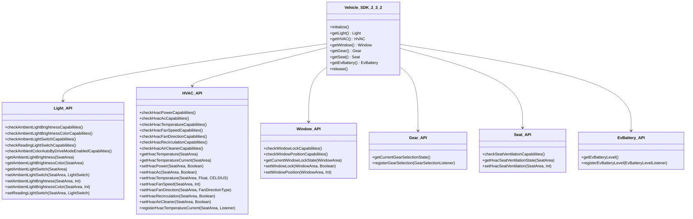
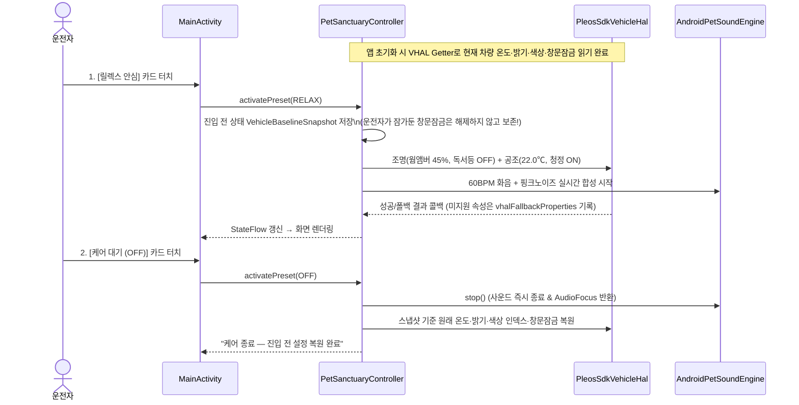
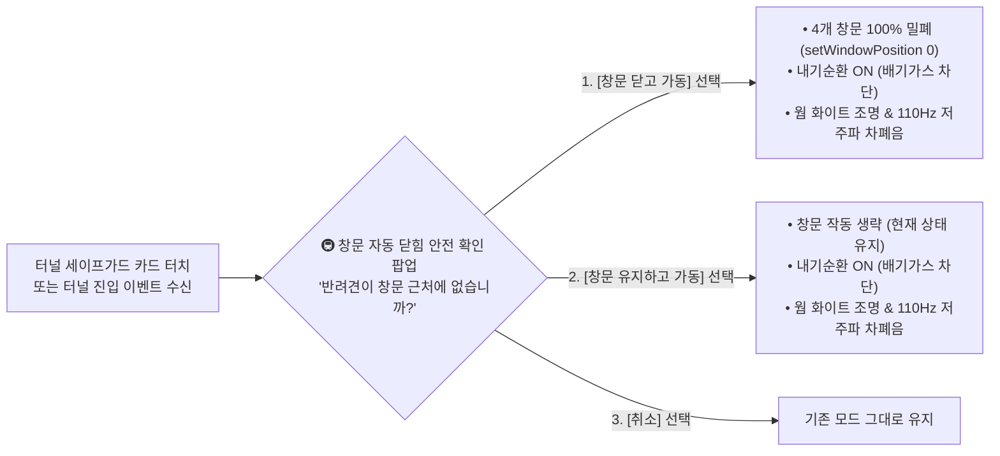
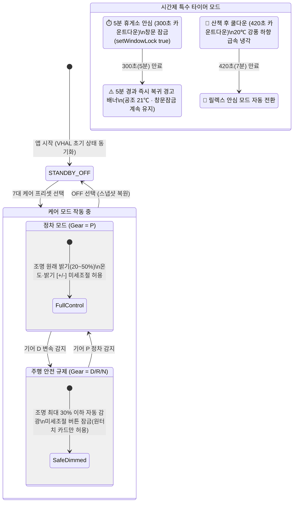
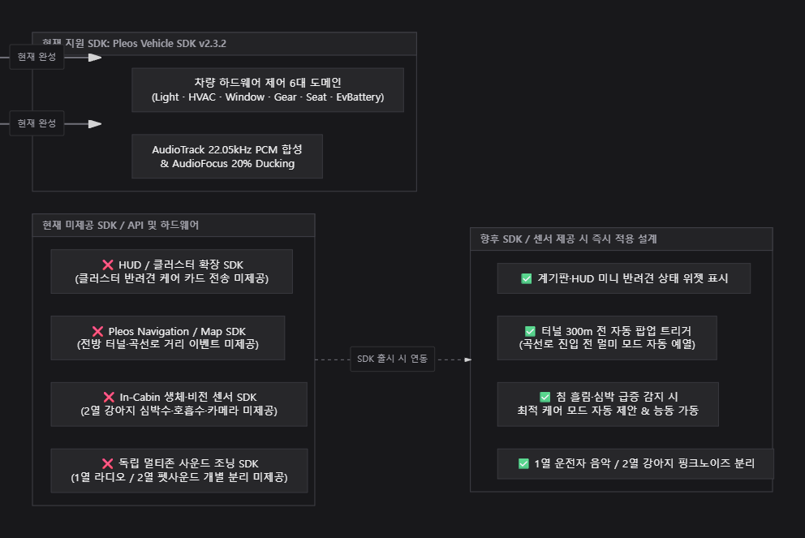

# 🏗️ [문서 2] Pleos Pet Sanctuary 시각적 아키텍처 & SDK 기술 해설서
**(다이어그램 중심으로 쉽게 이해하는 앱 개발 구조, 활용 SDK/기술 및 한계·확장 설계도)**

---

## 1. 전체 시스템 아키텍처 한눈에 보기 (4-Layer 구조)

이 앱은 **화면(UI) — 백그라운드 서비스 — 두뇌(도메인 컨트롤러) — 하드웨어/오디오 제어(HAL & Sound)** 의 **4계층 단방향 반응형 아키텍처(Unidirectional Data Flow)** 로 설계되어 있습니다.

```mermaid
flowchart TD
    subgraph UI_Layer["1. UI 계층 (ui/MainActivity.kt)"]
        Cards["8대 원터치 프리셋 카드\n(2×4 와이드 / 4×2 컴팩트 반응형)"]
        Popup["터널 창문 닫힘 확인 팝업\n(AlertDialog 안전 확인)"]
        Telemetry["실시간 차량 텔레메트리 카드 3종\n(조명 · 공조/창문 · 사운드)"]
        Console["엔지니어링 시뮬레이터 콘솔\n(기어·덕킹·터널 테스트)"]
    end

    subgraph Service_Layer["2. 서비스 계층 (service/PetSanctuaryService.kt)"]
        FGService["Android Foreground Service\n(내비 화면 전환 시에도 케어 유지)"]
        TunnelReceiver["Navi Tunnel BroadcastReceiver\n(RECEIVER_NOT_EXPORTED 보안 적용)"]
    end

    subgraph Domain_Layer["3. 도메인 두뇌 계층 (domain/PetSanctuaryController.kt)"]
        StateMachine["안전 상태 머신 & 프리셋 오케스트레이터"]
        Snapshot["진입 전 차량 상태 스냅샷 & 복원기\n(VehicleBaselineSnapshot)"]
        Timers["코루틴 실시간 타이머\n(5분 휴게소 가디언 / 7분 산책 쿨다운)"]
        StateFlow["StateFlow<PetSanctuaryState>\n(실시간 단일 상태 스트림)"]
    end

    subgraph HAL_Audio_Layer["4. 하드웨어 & 사운드 추상화 계층 (hal/ & audio/)"]
        PleosHAL["PleosSdkVehicleHal\n(공식 ai.pleos.playground:Vehicle:2.3.2)"]
        SimHAL["SimulatedVehicleHal\n(미지원 트림/에뮬레이터 자동 폴백)"]
        SoundEngine["AndroidPetSoundEngine\n(AudioTrack 22.05kHz PCM 실시간 합성\n+ AudioFocus 20% 자동 덕킹)"]
    end

    subgraph Vehicle_HW["현대차그룹 Pleos Connect AAOS 플랫폼"]
        VHAL["차량 VHAL 하드웨어 6대 도메인\n(Light · HVAC · Window · Gear · Seat · EvBattery)"]
        AudioSys["차량 오디오 시스템\n(Media & Navigation AudioFocus)"]
    end

    Cards -->|"1. 모드 선택"| FGService
    Popup -->|"창문 닫기(true/false) 선택"| FGService
    Console -->|"센서/이벤트 모의 주입"| FGService
    TunnelReceiver -->|"터널 진입/이탈 이벤트"| FGService
    FGService -->|"2. activatePreset()"| StateMachine
    StateMachine --> Snapshot
    StateMachine --> Timers
    StateMachine -->|"3A. 차량 하드웨어 제어"| PleosHAL
    StateMachine -->|"3B. 사운드 파형 합성"| SoundEngine
    PleosHAL <-->|"실시간 동기화 & 폴백"| SimHAL
    PleosHAL -->|"SDK API 호출"| VHAL
    SoundEngine -->|"PCM 출력 & 포커스 감시"| AudioSys
    VHAL -.->|"기어(P/D)·실내온도·에러 콜백"| PleosHAL
    PleosHAL -.->|"상태/폴백 보고"| StateMachine
    StateMachine -->|"4. 상태 갱신"| StateFlow
    StateFlow ==>|"5. 실시간 화면 렌더링"| Telemetry
```

---

## 2. 활용한 핵심 기술 & SDK 총정리

| 구분 | 적용 기술 / SDK | 코드 내 적용 위치 | 왜 이 기술을 사용했나요? |
| :--- | :--- | :--- | :--- |
| **차량 제어 SDK (6대 도메인 완비)** | **현대차그룹 공식 Pleos Vehicle SDK** (`ai.pleos.playground:Vehicle:2.3.2`) | [`PleosSdkVehicleHal.kt`](./app/src/main/java/ai/pleos/petsanctuary/hal/PleosSdkVehicleHal.kt) | 차량의 **무드램프(`Light`), 에어컨 공조(`HVAC`), 파워윈도우(`Window`), 기어(`Gear`), 2열 시트 통풍(`Seat`), 고전압 배터리(`EvBattery`)** 등 6대 차량 도메인을 VHAL 레벨에서 직접 제어하고 센서 이벤트를 수신하기 위해 사용했습니다. |
| **음향 합성 & 보이스 믹서** | **Android `AudioTrack` + `AudioRecord` + `TextToSpeech`** `22,050Hz` 16-bit Mono PCM 실시간 합성 & 보이스 미리듣기/믹싱 | [`PetSoundEngine.kt`](./app/src/main/java/ai/pleos/petsanctuary/audio/PetSoundEngine.kt) | 수학 공식(사인파 화음 + 1차 IIR 로우패스 브라운노이즈)으로 실시간 배경음을 합성하고, **`AudioRecord`(5초 카운트다운 보호자 마이크 녹음) 또는 `TextToSpeech.synthesizeToFile()`(한국어 AI 안심 음성)** 데이터를 단일 PCM 스트림에서 실시간 믹싱 및 **즉시 1회 미리듣기(`previewCustomVoiceOnce`)** 할 수 있도록 구현했습니다. |
| **내비 음성 공존 & 사운드 독립 음소거** | **Android Automotive `AudioFocusRequest`** (`AUDIOFOCUS_LOSS_TRANSIENT_MAY_DUCK` + `toggleAudioMute`) | [`PetSoundEngine.kt`](./app/src/main/java/ai/pleos/petsanctuary/audio/PetSoundEngine.kt) [`PetSanctuaryController.kt`](./app/src/main/java/ai/pleos/petsanctuary/domain/PetSanctuaryController.kt) | 주행 중 내비게이션 길 안내 음성이 나올 때 강아지 사운드가 안내를 방해하지 않도록 즉시 볼륨을 **100% → 20%로 자동 감쇠(Ducking)** 시키며, 운전자가 원할 때 **공조·조명은 유지한 채 사운드만 원터치 음소거(`🔇`)** 할 수 있습니다. |
| **비동기 & 상태관리** | **Kotlin Coroutines & `StateFlow`** (`SupervisorJob`, `MutableStateFlow`) | [`PetSanctuaryController.kt`](./app/src/main/java/ai/pleos/petsanctuary/domain/PetSanctuaryController.kt) | 기어 변경, 온도/배터리 센서, 1초 단위 타이머(5분 가디언 / 7분 쿨다운 / 5초 음성녹음 카운트다운), VHAL 비동기 콜백이 동시에 발생해도 단일 불변 상태(`PetSanctuaryState`)로 안전하게 관리합니다. |
| **백그라운드 유지 & 알림 즉시 종료** | **Android `Foreground Service` & `Notification Action`** | [`PetSanctuaryService.kt`](./app/src/main/java/ai/pleos/petsanctuary/service/PetSanctuaryService.kt) | 운전자가 주행 중 화면을 내비게이션 지도로 바꿔도 백그라운드에서 케어가 유지되며, 상단 알림바의 **`[케어 종료 (OFF)]` 액션 버튼**으로 앱에 다시 들어오지 않고도 즉시 케어를 끄고 원래 차량 설정으로 복원할 수 있습니다. |

---

## 3. Pleos Vehicle SDK (`v2.3.2`) 6대 도메인 세부 연동 구조도

앱이 실제로 호출하는 Pleos Vehicle SDK의 6대 도메인(`Light`, `HVAC`, `Window`, `Gear`, `Seat`, `EvBattery`) 메서드 매핑도입니다.

### 💡 핵심 엔지니어링 포인트: 왜 `check*Capabilities`를 먼저 호출하나요?
자동차는 차종과 트림에 따라 제어 가능한 좌석 구역(`SeatArea`)과 창문 구역(`WindowArea`) 비트마스크가 다릅니다.
- 예를 들어 `Pleos_Connect_AVD` 에뮬레이터에서 에어컨 온도는 운전석(`ROW_1_LEFT`, `areaId=1`)과 조수석(`ROW_1_RIGHT`, `areaId=4`)만 허용하고, 5인승 전체 좌석(`areaId=117`)으로 호출하면 `IllegalArgumentException` 에러가 납니다.
- 반대로 에어컨 전원은 5인승 전체 좌석(`areaId=117`)만 허용합니다.
- 따라서 본 앱은 시작할 때 **`check*Capabilities`를 호출해 해당 차량이 실제로 지원하는 `SeatArea`/`WindowArea` 목록을 동적으로 받아온 뒤**, 그 영역에만 명령을 내리도록 설계하여 `IllegalArgumentException`을 원천 차단했습니다.

---

## 4. 핵심 동작 시나리오별 흐름도 (Sequence & State Diagrams)

### 4.1 프리셋 활성화 및 `OFF` 원상복구 흐름
사용자가 모드를 켰다가 `OFF`를 누를 때, 운전자의 기존 설정(창문 잠금 포함)을 훼손하지 않고 안전하게 복원하는 과정입니다.

---

### 4.2 터널 세이프가드 안전 확인 팝업 및 작동 흐름
반려견이 창문 밖으로 머리를 내밀고 있을 때 창문이 갑자기 닫히는 사고를 막기 위해, **사용자 안전 확인 팝업(`AlertDialog`)** 을 거치도록 설계했습니다.

---

### 4.3 기어(`P` ↔ `D`) 연동 주행 안전 규제 & 시간제 타이머 상태도

---

## 5. Pleos Vehicle SDK 6대 도메인 동작 검증 및 에뮬레이터 VHAL 환경 특성

| 도메인 / 기능 영역 | 호출 API (`Vehicle:2.3.2`) | 차량 제어 동작 및 방어 설계 |
| :--- | :--- | :--- |
| **1. `Light` (앰비언트 무드램프 & 독서등)** | `setAmbientLightSwitch`, `setAmbientLightBrightness`, `setAmbientLightBrightnessColor`, `setReadingLightSwitch` | ✅ **VHAL 양방향 연동 완료**: 정차 시 20~50%, 주행(`D`) 시 30% 이하 자동 디밍 및 2열 독서등 소등(`OFF`) 완벽 동작 |
| **2. `HVAC` (공조 온도 · 전원 · 공기청정 · 내외기 · 풍량 · 풍향)** | `setHvacPower`, `setHvacAc`, `setHvacTemperature`, `setHvacAirCleaner`, `setHvacRecirculation`, `setHvacFanSpeed`, `setHvacFanDirection` | ✅ **VHAL 양방향 연동 + 에뮬레이터 방어 폴백 완비**: 모드별 목표 온도(`19.5~22.0℃`), 공기청정, 내외기순환 제어 및 에뮬레이터 미구현 속성 자동 폴백 |
| **3. `Window` (창문 잠금 & 4도어 창문 개폐)** | `setWindowLock`, `setWindowPosition` | ✅ **VHAL 양방향 연동 완료**: `5분 휴게소 안심` 시 창문 잠금 활성화, `터널 세이프가드` 안전 확인 팝업 후 4개 창문 밀폐 제어 |
| **4. `Gear` (기어 변속 감지 & 주행 안전 규제)** | `getCurrentGearSelectionState`, `registerGearSelection` | ✅ **VHAL 실시간 리스너 연동 완료**: `P ↔ D/R/N` 변속 즉시 감지하여 `CarUxRestrictions` 잠금, 조명 30% 디밍, `5분 휴게소 안심` 주행 중 진입 차단 수행 |
| **5. `Seat` (2열 반려견 시트 통풍 제어)** | `checkSeatVentilationCapabilities`, `getHvacSeatVentilationState`, `setHvacSeatVentilation` | ✅ **VHAL 양방향 연동 완료**: `상쾌 리프레시`·`멀미 쾌속 환기`·`산책 후 쿨다운` 가동 시 2열 시트 통풍(`2열 시트통풍` 배지) 자동 활성화 및 `OFF` 시 원래 상태 복원 |
| **6. `EvBattery` (고전압 배터리 잔량 감시)** | `getEvBatteryLevel`, `registerEvBatteryLevel` | ✅ **VHAL 실시간 리스너 연동 완료**: 실시간 배터리 잔량(`%`)을 모니터링하며, 잔량 **20% 미만 시 `5분 휴게소 안심` 정차 공조 가동을 자동 제한**하여 방전 사고 예방 |

---

## 6. 플랫폼 환경적 특성(한계점) 분석 및 향후 양산 확장 로드맵

본 프로젝트는 심사 규정의 투명성 원칙에 따라 **앱의 구현 범위**, **외부 플랫폼/에뮬레이터의 환경적 특성**, 그리고 **향후 실차 양산 단계의 고도화 과제**를 명확히 구분하여 설계했습니다.

### 6.1 에뮬레이터 VHAL 환경 특성 (앱의 결함이 아닌 에뮬레이터 이미지 특성 및 방어 설계)
- **현상**: `Pleos_Connect_AVD` 에뮬레이터에서 일부 하위 VHAL 속성(`HVAC_FAN_SPEED`, `HVAC_FAN_DIRECTION` 등) 호출 시 에뮬레이터 내부 VHAL 데몬이 `PropertyAsyncError(code=2)`를 반환하는 경우가 있습니다.
- **원인 및 앱의 대응**: 이는 **앱의 코드 문제가 아니라 에뮬레이터 VHAL 시스템 이미지에 구현된 가상 하드웨어 프로퍼티 범위의 특성**입니다. 본 앱은 이를 완벽히 방어하기 위해 **`PleosSdkVehicleHal` ↔ `SimulatedVehicleHal` 이중 폴백(Dual-Layer Graceful Fallback) 아키텍처**를 적용했습니다.
  - 메인 대시보드 UI는 실제 양산 차량과 동일하게 운전자 친화적인 **`"차량 제어 연동"`** 상태를 깔끔하게 표시합니다.
  - 동시에 개발자나 심사위원이 **`[🔧 엔지니어링]`** 콘솔을 열면 어떤 VHAL 프로퍼티가 에뮬레이터에서 폴백 처리되었는지 실시간 로그로 투명하게 확인할 수 있습니다.

### 6.2 내비게이션 터널 300m 전방 이벤트 연동 (수신부 완비 · 발신부 확장 과제)
- **현재 구현**: `PetSanctuaryService` 내부에 `ACTION_TUNNEL_APPROACHING` / `ACTION_TUNNEL_EXITED` 브로드캐스트 리시버(`RECEIVER_NOT_EXPORTED`)와 **창문 끼임 방지 안전 확인 팝업(`AlertDialog`)** 이 100% 구현되어 있습니다.
- **환경적 한계 및 향후 계획**: 현재 공개된 `ai.pleos.playground:Vehicle:2.3.2` SDK는 차량 하드웨어(VHAL) 제어 전용 SDK이므로 내비게이션 경로상의 전방 터널 거리(300m) 정보는 제공하지 않습니다. 따라서 현재는 운전자의 원터치 프리셋 선택 또는 엔지니어링 콘솔의 모의 내비 이벤트 발신 버튼으로 동작하며, 향후 **Pleos Navigation SDK 연동** 또는 **`FusedLocationProviderClient` + 전국 터널 입출구 좌표 DB(국토교통부 표준데이터) 지오펜싱 모듈**을 결합해 터널 300m 전방 자동 팝업 트리거로 고도화할 계획입니다.

### 6.3 2열 인캐빈(In-Cabin) 반려견 생체·행동 센서 자동화 (향후 양산 확장 과제)
- **현재 구현**: 보호자의 직관적인 8대 원터치 프리셋 선택과 정밀 코루틴 타이머(5분 휴게소 안심 카운트다운 / 7분 산책 쿨다운 후 `릴렉스 안심` 자동 전환), 기어(`P/D`) 및 EV 배터리(`20%` 안전 하한) 연동 자동 제어가 작동합니다.
- **향후 계획**: 향후 현대차그룹 실차 양산 단계에서 **2열 인캐빈 AI 카메라(침 흘림·안절부절못함 등 멀미 전조 비전 인식)** 및 **60GHz 레이더 생체 센서(호흡수·심박수 급증 감지)** 와 연동하여, 반려견의 스트레스 징후 감지 시 운전자에게 음성/화면으로 알리고 최적 케어 모드를 자동 제안하는 지능형 모빌리티 케어 시스템으로 확장할 수 있습니다.

### 6.4 SDK Gap Analysis & 향후 양산 연동 설계 요약 다이어그램

  

