# 📖 [별도 매뉴얼] Pleos Pet Sanctuary 시각적 사용 설명서 (실제 앱 캡처 + 실내 공간 렌더링)

> **안내**: 본 문서는 기존 문서들을 수정하지 않고 별도로 제작된 **실제 가동 화면(`Pleos_Connect_AVD` 에뮬레이터 실행 캡처) + 차량 실내 공간 가상 렌더링(Cabin Visualization) 통합 사용 설명서**입니다.  
> 운전자가 화면의 버튼을 눌렀을 때 **① 센터 디스플레이 화면이 어떻게 바뀌는지**와 **② 실제 차량 뒷좌석 실내 공간(조명·공조 기류·창문·사운드 파형)이 어떻게 변하는지**를 나란히 비교하며 이해하실 수 있습니다. 모든 이미지 원본은 [`./manual_screenshots/`](./manual_screenshots/) 폴더에 저장되어 있습니다.

---

## 1. 기본 화면 구성 & `🐶 릴렉스 안심` 모드 따라하기

### 1.1 센터 디스플레이 앱 실행 화면 (`릴렉스 안심` 모드)
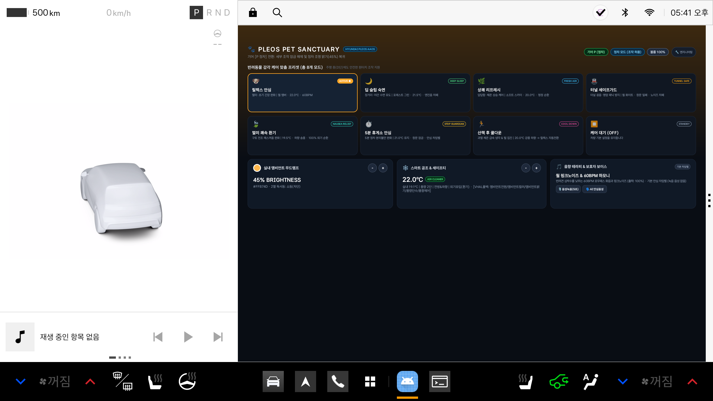

### 1.2 실제 차량 2열 실내 공간 변화 렌더링 (`릴렉스 안심` & `딥 슬립`)
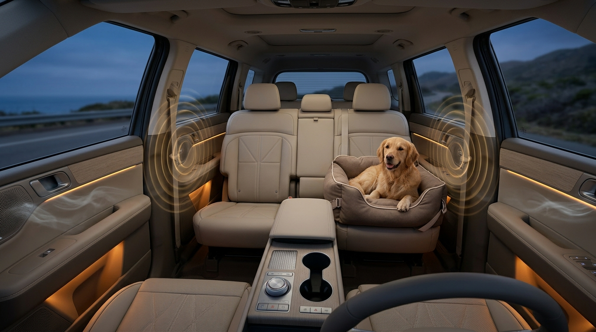

### 화면 영역별 구성 및 실내 변화 해설
1. **상단 상태 바 (`PLEOS PET SANCTUARY`)**:
   - **`[기어 P (정차)]`** · **`[정차 모드 (조작 허용)]`** · **`[볼륨 100%]`** 배지로 현재 차량 상태와 안전 규제 여부를 표시합니다.
2. **중앙 8대 원터치 프리셋 카드 (`🐶 릴렉스 안심` 선택 시)**:
   - 운전자가 **`🐶 릴렉스 안심`** 카드를 원터치하면 카드에 노란 테두리와 **`ACTIVE ●`** 배지가 켜집니다.
3. **실제 차량 실내 공간에서 일어나는 변화**:
   - **조명 (`Vehicle.getLight()`)**: 강아지가 가장 편안함을 느끼는 **웜 앰버(`#FFB74D`, 밝기 45%)** 무드램프가 도어 트림을 따라 은은하게 켜지고, 강아지 눈부심을 유발하는 **2열 천장 독서등은 자동으로 소등(`OFF`)** 됩니다.
   - **공조 (`Vehicle.getHVAC()`)**: 목표 온도 **`22.0℃`**, 풍량 2단, **공기청정(`AIR CLEANER`)** 이 동시에 켜져 쾌적한 공기를 순환시킵니다.
   - **사운드 (`AndroidPetSoundEngine`)**: 양쪽 도어 스피커에서 대형견의 안정 시 심박수와 유사한 **60BPM(1Hz) 로우패스 화음과 따뜻한 핑크노이즈 파형**이 흘러나와 초기 탑승 긴장을 풀어줍니다.

---

## 2. 핵심 기능별 상세 조작법 & 실내 공간 효과

### 2.1 ⏱️ 5분 휴게소 안심 가디언 + 🎙️ 보호자 안심 보이스(녹음/TTS) 믹싱

휴게소 등에서 5분 이내로 잠시 정차할 때 **강아지가 창문 스위치를 밟아 탈출하는 사고를 막고, 보호자의 목소리로 분리불안을 달래주는 기능**입니다.

#### ① 센터 디스플레이 앱 실행 화면 (`5분 휴게소 안심` + `보이스 ON`)
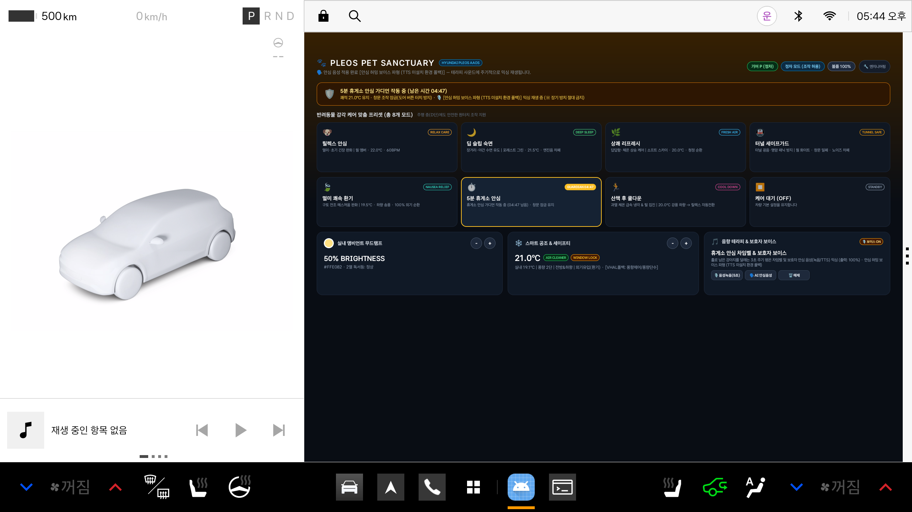

#### ② 실제 차량 2열 실내 공간 변화 렌더링 (`창문 스위치 잠금` & `보호자 보이스 파형`)

#### 따라하기 순서 및 실내 작동 원리
1. **`⏱️ 5분 휴게소 안심` 카드 터치**:
   - 앱 상단에 주황색 **`🛡️ 5분 휴게소 안심 가디언 작동 중 (남은 시간 04:47)`** 배너가 켜지며 300초(`05:00 → 00:00`) 실시간 카운트다운이 시작됩니다.
2. **도어 창문 스위치 잠금 (`WINDOW LOCK` — 실내 렌더링 참조)**:
   - 강아지가 보호자를 찾으려고 도어 팔걸이(암레스트)에 앞발을 올리더라도, **`setWindowLock(true)`** 명령이 작동해 **도어 창문 스위치가 잠겨(황금색 자물쇠 방패 표시) 창문이 절대 열리지 않습니다.**
3. **보호자 안심 보이스 믹싱 (`[🎙️ 음성녹음(5초)]` 또는 `[🗣️ AI 안심음성]`)**:
   - 정차(`기어 P`) 상태에서 우측 하단 카드의 **`[🎙️ 음성녹음(5초)]`** 버튼을 눌러 보호자의 목소리를 직접 녹음하거나, 마이크가 없는 에뮬레이터에서는 **`[🗣️ AI 안심음성]`** 버튼을 누릅니다.
   - 즉시 **`🎙️ 보이스 ON`** 배지가 켜지며, 실내 스피커에서 평온한 차임벨과 함께 **보호자의 다정한 안심 음성 파형이 주기적으로 믹싱 재생**되어 홀로 남은 강아지를 안심시킵니다.
   - 5분이 지나면 상단 배너가 **`⚠️ 5분 휴게소 안심 시간 경과! 즉시 차량으로 복귀해 주세요`** 로 바뀌어 장기 방치를 경고합니다(공조 `21.0℃`와 창문 잠금은 계속 유지).

---

### 2.2 🍃 멀미 쾌속 환기 & 🏃 산책 후 쿨다운 (반려견 맞춤 하향 송풍 & 7분 타이머)

강아지가 멀미 전조(침 흘림·하품)를 보이거나, 야외 산책 직후 체온이 올라 헐떡일 때 사용하는 기능입니다.

#### ① 실제 차량 실내 공간 변화 렌더링 (`바닥 하향 송풍(FLOOR)` & `공기청정 집진`)
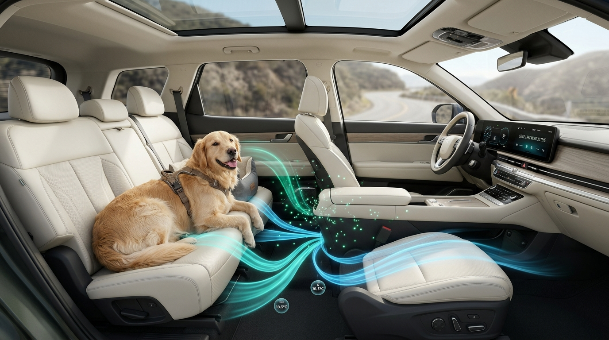

#### ② 센터 디스플레이 앱 실행 화면 (`산책 후 쿨다운 7분 타이머` & `멀미 쾌속 환기`)
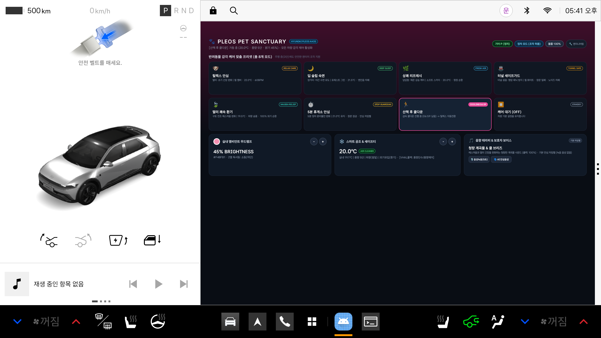

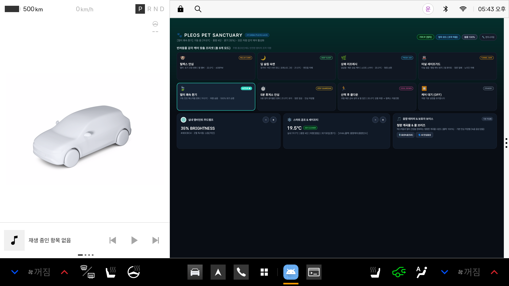

#### 왜 '하향 송풍(`FanDirectionType.FLOOR`)'으로 작동하나요?
- 사람과 달리 강아지는 에어컨 찬 바람이 얼굴과 코·눈에 직접 닿으면 심한 안구 건조와 불안감을 느낍니다.
- 따라서 **`🍃 멀미 쾌속 환기`** 와 **`🏃 산책 후 쿨다운`** 모드는 실내 렌더링 이미지에서 보듯 **차가운 공기(`19.5℃ ~ 20.0℃`)를 바닥 송풍구(`FLOOR`)로만 내보내어 시트 아래에서 위로 부드럽게 감싸 오르도록** 제어합니다.
- 동시에 센터 콘솔의 **공기청정(`AIR CLEANER`, 초록색 입자)** 기능을 가동해 산책 후 날리는 털과 미세먼지를 빠르게 포집하며, **`🏃 산책 후 쿨다운`** 은 **7분(`07:00 → 00:00`) 타이머 종료 시 자동으로 `🐶 릴렉스 안심`(`22.0℃`) 모드로 전환**되어 과냉각을 방지합니다.

---

### 2.3 🚇 터널 세이프가드 (창문 끼임 확인 팝업 + 4도어 창문 밀폐 + 내기순환)

터널 진입 시 급격한 반사 굉음과 매연, 어두워지는 조도로 인해 강아지가 패닉에 빠지는 것을 막아주는 기능입니다.

#### ① 실제 차량 실내 공간 변화 렌더링 (`4개 창문 완전 밀폐` + `내기순환 에어 실드`)
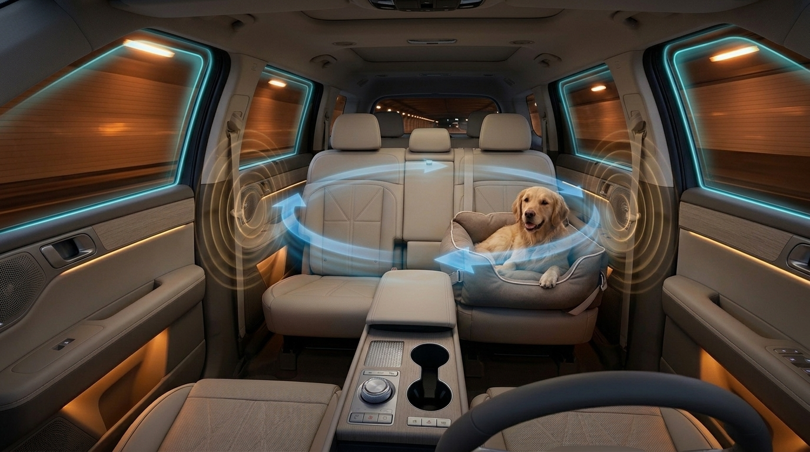

#### ② 센터 디스플레이 앱 실행 화면 (`터널 세이프가드`)
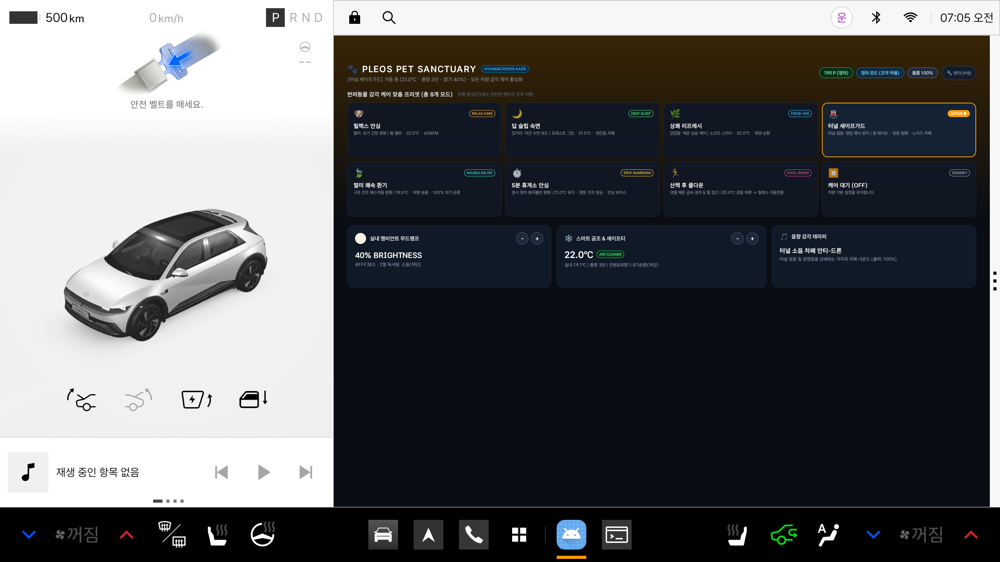

#### 따라하기 순서 및 실내 작동 원리
1. **`🚇 터널 세이프가드` 카드 터치 → 안전 확인 팝업**:
   - 카드를 누르면 창문이 갑자기 닫히며 강아지가 다치는 일을 막기 위해 **"반려견이 창문 밖으로 머리나 발을 내밀고 있지 않은지 확인하셨습니까?"** 팝업(`AlertDialog`)이 먼저 뜹니다.
2. **`[창문 닫고 가동]` 선택 시 실내 공간 변화**:
   - **4개 창문 100% 밀폐 (`setWindowPosition(0)`)**: 열려 있던 창문이 모두 닫히며 터널 벽면 반사 굉음을 물리적으로 차단합니다.
   - **내기순환 전환 (`setHvacRecirculation(true)`)**: 실내 렌더링의 하늘색 순환 화살표처럼 외부 터널 매연 유입을 완벽히 차단하고 차내 공기만 정화 순환시킵니다.
   - **웜 화이트 조명 & 110Hz 저주파 차폐음**: 터널 진입 시 갑작스러운 암전 불안감을 막기 위해 실내를 부드러운 웜 화이트(`40%`)로 밝히고, 스피커에서 110Hz/55Hz 저주파 차폐 사운드를 내보내 터널 공명음을 상쇄합니다.

---

### 2.4 🚗 기어 `D(주행)` 안전 잠금(`CarUxRestrictions`) & 내비게이션 20% 자동 덕킹

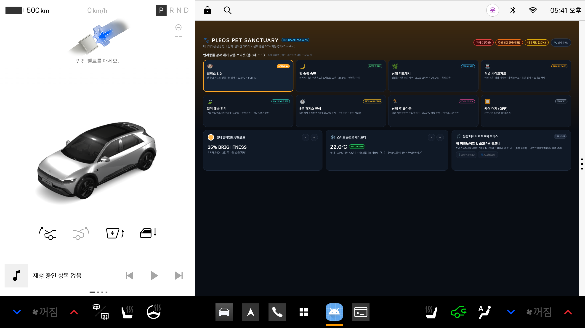

- 운전자가 기어를 **`D(주행)`** 로 변속하면:
  1. 야간 운전 시 실내 무드램프가 앞유리에 반사되어 시야를 가리지 않도록 **무드램프 밝기를 즉시 `25%` (최대 30% 이하)로 자동 감광**합니다.
  2. 주행 중 시선을 빼앗는 **온도·밝기 `[-]` `[+]` 버튼과 `[🎙️ 음성녹음(5초)]` · `[🗣️ AI 안심음성]` 버튼이 반투명하게 잠기며**, 큰 원터치 프리셋 카드만 조작할 수 있습니다.
  3. 내비게이션 길 안내 음성이 나오면 상단에 노란색 **`[내비 덕킹 (20%)]`** 배지가 켜지고 **테라피 사운드와 보호자 보이스 볼륨이 즉시 20%로 낮아졌다가**, 안내 종료 후 100%로 자동 복구됩니다.

---

### 2.5 🔧 엔지니어링 가상 시뮬레이터 콘솔 & `⏹ 케어 대기(OFF)` 원상 복원

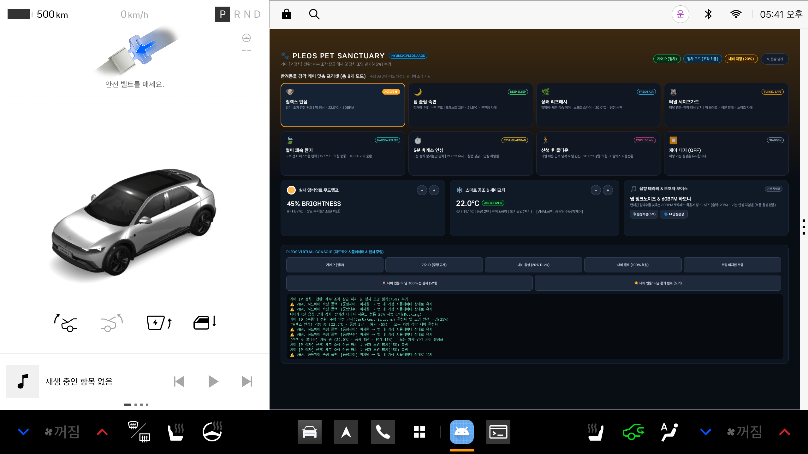

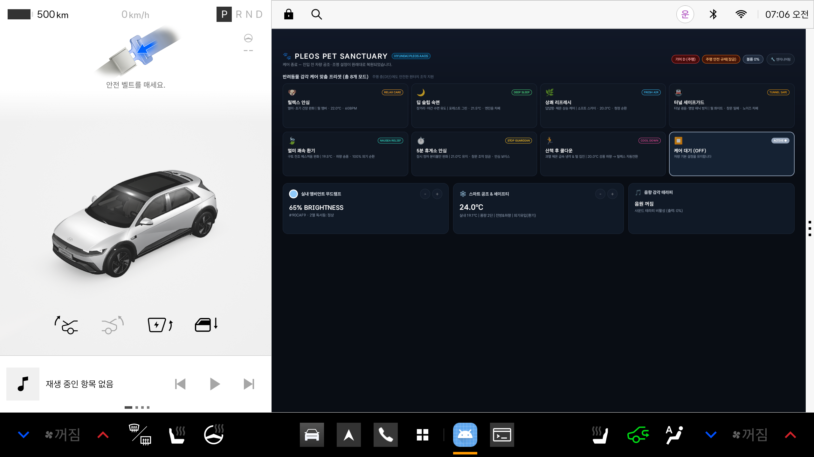

- **`🔧 엔지니어링` 콘솔**: 우측 상단 **`[🔧 엔지니어링]`** 버튼을 누르면 하단에 시뮬레이터 패널이 열려 기어 `P/D` 전환, 내비 음성 20% 덕킹, 트림 미지원 토글, 터널 300m 전 감지 모의 버튼을 즉시 테스트하고 실시간 SDK 로그를 확인할 수 있습니다.
- **`⏹ 케어 대기 (OFF)`**: 목적지 도착 후 `OFF` 카드를 누르면 사운드가 꺼지고, 앱을 켜기 전 운전자의 원래 공조 온도(`24.0℃`), 원래 조명 밝기(`65%`), 원래 창문 잠금 상태로 완벽하게 되돌아갑니다.
