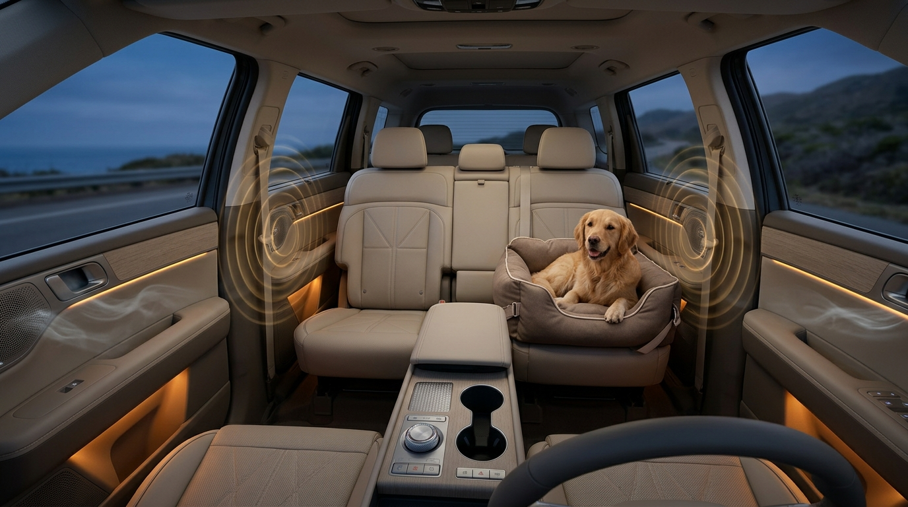
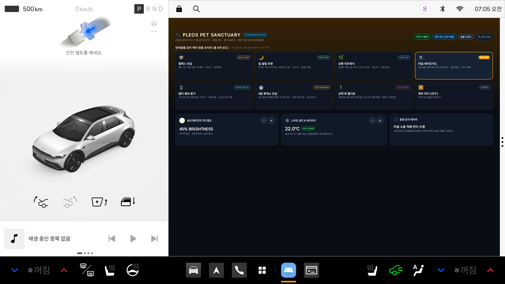
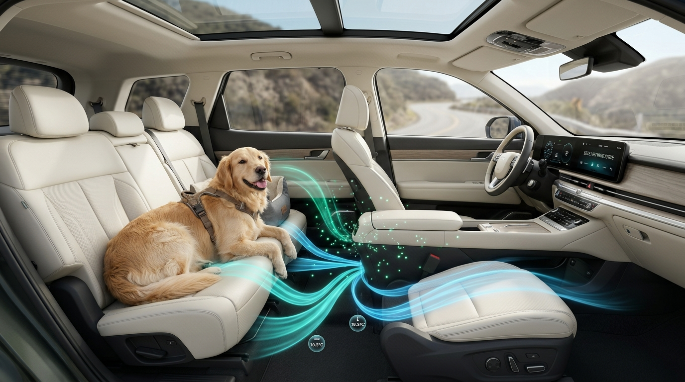
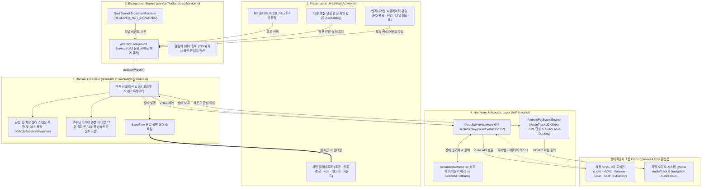

# 🐾 Pleos Pet Sanctuary (플레오스 펫 힐링 라운지)
> **현대자동차그룹 Pleos Connect AAOS 기반 반려견 감각 케어 & 인포테인먼트 오케스트레이션 시스템**  
> *Seamless In-Vehicle Sensory Sanctuary for Canine Passengers powered by Hyundai Motor Group Pleos Vehicle SDK (v2.3.2)*

---

## 📌 목차
1. [프로젝트 소개](#1-프로젝트-소개)
2. [실제 가동 화면 & 실내 공간 시뮬레이션 (Visual Manual)](#2-실제-가동-화면--실내-공간-시뮬레이션-visual-manual)
3. [시스템 아키텍처 & 기술 스택](#3-시스템-아키텍처--기술-스택)
4. [Pleos Vehicle SDK 6대 도메인 연동 명세](#4-pleos-vehicle-sdk-6대-도메인-연동-명세)
5. [설치 및 실행 가이드](#5-설치-및-실행-가이드)
6. [단위 테스트 및 안전성 검증](#6-단위-테스트-및-안전성-검증)
7. [프로젝트 산출물 문서 안내](#7-프로젝트-산출물-문서-안내)

---

## 1. 프로젝트 소개

반려견과 함께하는 드라이빙은 즐겁지만, 반려견에게 차량 내부는 **엔진·노면 진동, 터널 진입 시 급격한 조도 변화와 공명음, 급정거·차선 변경으로 인한 멀미, 휴게소 정차 시의 분리불안** 등 극심한 감각적 스트레스를 유발하는 공간입니다.

**Pleos Pet Sanctuary (플레오스 펫 힐링 라운지)** 는 이러한 문제를 해결하기 위해 개발된 **Android Automotive OS(AAOS) 전용 앱**입니다.
- 현대차그룹 **Pleos Vehicle SDK(`Vehicle:2.3.2`)의 6대 차량 도메인(`Light`, `HVAC`, `Window`, `Gear`, `Seat`, `EvBattery`)** 을 단일 오케스트레이션 엔진으로 통합 제어합니다.
- 복잡한 개별 공조·조명 조작 없이 **8대 원터치 프리셋**으로 최적의 실내 환경을 구성합니다.
- **실시간 절차적 오디오 합성(`AudioTrack` 22,050Hz PCM) 및 내비게이션 길 안내 자동 감쇠(AudioFocus 20% Ducking)** 가 유기적으로 결합되어 주행 안전성과 반려견의 심리 안정을 동시에 달성합니다.

---

## 2. 실제 가동 화면 & 실내 공간 시뮬레이션 (Visual Manual)

본 프로젝트는 에뮬레이터 UI와 실차 실내 렌더링을 1:1로 매핑하여 직관적인 이해를 돕습니다.

### ① 릴렉스 안심 (RELAX CARE)
> **"멀미와 초기 탑승 긴장을 가라앉히는 따뜻한 앰버 무드와 60BPM 심박 안정 테라피"**  
> • **차량 제어**: 웜 앰버 조명 (45% 정차 / 25% 주행) · 22.0℃ 쾌적 공조 · 공기청정 ON · 2열 독서등 차단(눈부심 방지)  
> • **음향 테라피**: 60BPM 핑크노이즈 화음 실시간 합성 출력

| 실제 작동 AAOS 콕핏 대시보드 화면 | 차량 실내 공간 가상 렌더링 시뮬레이션 |
| :---: | :---: |
|  |  |

---

### ② 터널 세이프가드 (TUNNEL SAFEGUARD)
> **"터널 진입 시 급격한 굉음과 조도 변화 패닉 방지 & 반려견 끼임 방지 안전 확인 팝업"**  
> • **차량 제어**: 웜 화이트 조명 (40%) · 내기순환 100% (유독가스 차단) · 창문 4개 100% 밀폐 (`setWindowPosition 0`)  
> • **안전 팝업**: 반려견이 머리를 내밀고 있을 때 창문이 닫히는 사고를 막는 `AlertDialog` 확인 단계  
> • **음향 테라피**: 110Hz·55Hz 터널 저주파 공명음 상쇄 차폐 드론

| 터널 창문 닫힘 안전 확인 팝업 | 터널 진입 세이프가드 가동 대시보드 |
| :---: | :---: |
|  |  |

| 터널 주행 중 차량 실내 공간 시뮬레이션 |
| :---: |
|  |

---

### ③ 멀미 쾌속 환기 & 산책 후 쿨다운 (NAUSEA RELIEF & COOLDOWN)
> **"구토 전조 멀미 완화 & 과열 체온 급속 냉각: 하향 송풍과 2열 시트 통풍 가동"**  
> • **차량 제어**: 19.5~20.0℃ 급속 쿨링 · **얼굴 직바람 방지 하향 송풍(`FLOOR`)** · **2열 반려견 시트 통풍(`Seat`) 가동** · 100% 외기 순환  
> • **자동 전환 타이머**: 산책 후 쿨다운 7분(420초) 경과 시 자동으로 `릴렉스 안심` 모드로 부드럽게 복귀

| 멀미 쾌속 환기 대시보드 | 7분 산책 쿨다운 타이머 대시보드 |
| :---: | :---: |
|  |  |

| 하향 에어플로우 & 2열 시트 통풍 실내 시뮬레이션 |
| :---: |
|  |

---

### ④ 5분 휴게소 안심 & 보호자 안심 음성 (STOP GUARDIAN & OWNER VOICE)
> **"잠깐 하차 시 분리불안 완화 & 도어 버튼 터치 방지 창문 잠금 & 보호자 목소리 믹싱"**  
> • **차량 제어**: 21.0℃ 공조 유지 · **창문 조작 잠금(`setWindowLock true`)** · **배터리 20% 미만 진입 차단 가드**  
> • **보호자 음성**: 마이크 5초 녹음 또는 AI 한국어 TTS 안심 음성 단일 스트림 주기적 믹싱 & **즉시 미리듣기(`▶️`)**  
> • **안전 타이머**: 5분(300초) 실시간 카운트다운 후 즉시 복귀 경고 배너 표출 (방치 사고 예방)

| 5분 휴게소 안심 가디언 대시보드 | 주행(D단) 전환 안전 규제 & 내비 20% 덕킹 |
| :---: | :---: |
|  |  |

| 보호자 음성과 함께하는 휴게소 안심 실내 시뮬레이션 |
| :---: |
|  |

---

## 3. 시스템 아키텍처 & 기술 스택

본 앱은 **단방향 데이터 흐름(Unidirectional Data Flow)** 과 엄격한 **4계층 분리 아키텍처**로 설계되어 있습니다.



### 핵심 적용 기술
- **Language**: Kotlin 1.9.24 (Coroutines, StateFlow, SupervisorJob)
- **Target OS**: Android Automotive OS (AAOS API 28~34)
- **Automotive SDK**: `ai.pleos.playground:Vehicle:2.3.2` (현대차그룹 공식 Vehicle SDK)
- **Audio Synthesizer**: Low-latency `AudioTrack` (22,050Hz 16-bit Mono PCM, 1차 IIR 브라운노이즈 & 60BPM 화음 절차적 실시간 생성)
- **Voice System**: `AudioRecord` (마이크 직접 녹음 5초) + `TextToSpeech` (한국어 안심 음성) 단일 스트림 믹싱
- **Safety Compliance**: `CarUxRestrictions` (주행 중 조명 디밍 30% 이하 및 미세조절/음성녹음 잠금, 정차 P 전용 가디언 가드)

---

## 4. Pleos Vehicle SDK 6대 도메인 연동 명세

| 도메인 | 사용 API (`Vehicle:2.3.2`) | 역할 및 안전 방어 로직 |
| :--- | :--- | :--- |
| **💡 Light** | `setAmbientLightSwitch`<br>`setAmbientLightBrightness`<br>`setAmbientLightBrightnessColor`<br>`setReadingLightSwitch` | • 프리셋별 감각 조명(웜 앰버, 포레스트 그린, 웜 화이트 등) 연동<br>• **주행(D단) 전환 시 30% 이하 자동 디밍(`CarUxRestrictions`)**<br>• 2열 독서등 강제 소등(`setReadingLightSwitch(OFF)`)으로 반려견 눈부심 차단 |
| **❄️ HVAC** | `setHvacPower`, `setHvacAc`<br>`setHvacTemperature`<br>`setHvacFanSpeed`, `setHvacFanDirection`<br>`setHvacRecirculation`, `setHvacAirCleaner` | • 모드별 최적 온도(19.5~22.0℃) 및 공기청정기 항시 가동<br>• 멀미 전조 시 **얼굴 직바람 방지 하향 송풍(`FLOOR`)** 및 외기 환기<br>• 터널 진입 시 유독가스 차단 내기순환(`recirculation = true`) 자동 전환 |
| **🪟 Window** | `setWindowLock`<br>`setWindowPosition` | • `5분 휴게소 안심` 시 반려견 발 터치 사고 방지 창문 조작 잠금<br>• `터널 세이프가드` 안전 확인 팝업 거친 후 4도어 창문 100% 밀폐 |
| **🕹️ Gear** | `getCurrentGearSelectionState`<br>`registerGearSelection` | • 기어 변속(P ↔ D/R/N) 실시간 감지 리스너 연동<br>• 주행 중 미세조절 차단 및 `5분 휴게소 안심` 주행 중 가동 원천 차단 |
| **💺 Seat** | `checkSeatVentilationCapabilities`<br>`setHvacSeatVentilation` | • `상쾌 리프레시` · `멀미 쾌속 환기` · `산책 후 쿨다운` 가동 시 **2열 반려견 전용 시트 통풍 자동 작동** (`OFF` 시 기존 상태 복원) |
| **🔋 EvBattery** | `getEvBatteryLevel`<br>`registerEvBatteryLevel` | • 고전압 배터리 실시간 잔량 모니터링<br>• **배터리 잔량 20% 미만 시 정차 중 방전을 막기 위해 `5분 휴게소 안심` 가동 자동 차단** |

---

## 5. 설치 및 실행 가이드

### 방법 A. 제공된 Release APK 직접 설치 (가장 빠르고 권장)
저장소의 `apk/` 디렉터리에 사전 빌드된 최신 릴리즈 APK가 포함되어 있습니다.

```bash
# 1. Pleos Connect AAOS 에뮬레이터 또는 실차 타깃 기기 연결 후 설치
adb install -r apk/PleosPetSanctuary_release.apk

# 2. 메인 액티비티 실행
adb shell am start -n ai.pleos.petsanctuary/.ui.MainActivity
```

### 방법 B. 소스 코드 빌드 및 실행
```bash
# 1. 유닛 테스트 전체 실행 (20개 도메인/안전/오디오 테스트 검증)
./gradlew testDebugUnitTest

# 2. Release 및 Debug APK 빌드
./gradlew assembleDebug assembleRelease
```

---

## 6. 단위 테스트 및 안전성 검증

Pleos Pet Sanctuary는 철저한 **무검증 완료 보고 금지(Zero-Assumption Verification)** 원칙에 따라, 핵심 비즈니스 로직과 안전 가드에 대해 **20개 JUnit 테스트**를 구축하고 100% 무결점을 검증했습니다.

```
[Gradle Unit Test Results - 20 Tests Passed in 0.169s]
  PASS: nauseaRelief_setsFloorDirectionFreshAirAndCoolTemp
  PASS: boundsClamping_clampsOutOfRangeTemperatureAndBrightness
  PASS: gracefulDegradation_handlesLowerTrimWithoutAmbientLightOrAirCleaner
  PASS: snapshotRestore_restoresOriginalVehicleSettingsWhenTurnedOff
  PASS: ownerVoiceRecordingAndTts_succeedInParkAndClearCorrectly
  PASS: windowLockPreservation_doesNotUnlockExistingDriverWindowLockInNonGuardianModes
  PASS: postPlayCooldown_transitionsAutomaticallyToRelaxAfterSevenMinutes
  PASS: tunnelSafeguard_sealsWindowsEnablesRecirculationAndNoiseDrone
  PASS: rearSeatVentilation_activatesForCoolingModesAndRestoresOnOff
  PASS: toggleAudioMute_mutesAndRestoresIndependentlyOfClimateAndNaviDucking
  PASS: previewCustomVoice_playsRecordedVoiceAndRespectsDrivingLock
  PASS: audioFocusDucking_reducesVolumeForNavigationAndRecovers
  PASS: ownerVoiceControls_blockedDuringDrivingByCarUxRestrictions
  PASS: gearTransition_enforcesSafeDrivingDimmingAndCarUxRestrictions
  PASS: quickStopGuardian_locksWindowsAndActivatesGuardianVoice
  PASS: postPlayCooldown_setsHighFanAndCooldownTimer
  PASS: presetActivation_appliesLightHvacAndAudioCorrectly
  PASS: quickStopGuardian_countsDownFiveMinutesAndEmitsExpiryWarning
  PASS: tunnelSafeguard_respectsWindowCloseConfirmationOverride
  PASS: quickStopGuardian_blockedDuringDrivingAndWhenEvBatteryLow
```

---

## 7. 프로젝트 산출물 문서 안내

저장소 루트에 프로젝트의 세부 기획·아키텍처·시각 가이드 및 공모전 제출 서류가 포함되어 있습니다.

- 📄 [`1_USER_GUIDE_AND_FEATURES.md`](1_USER_GUIDE_AND_FEATURES.md): 8대 프리셋 상세 기능 및 UX 시나리오 설명서
- 🏗️ [`2_ARCHITECTURE_AND_SDK_VISUAL_GUIDE.md`](2_ARCHITECTURE_AND_SDK_VISUAL_GUIDE.md): 4계층 아키텍처 다이어그램 및 Pleos SDK 심층 기술 명세서
- 📝 [`3_CONTEST_APPLICATION_DRAFT.md`](3_CONTEST_APPLICATION_DRAFT.md): 현대차그룹 공모전 심사 규정 준수 공식 참가 신청서 초안
- 🖼️ [`4_VISUAL_SCREEN_USER_MANUAL.md`](4_VISUAL_SCREEN_USER_MANUAL.md): 실제 캡처 화면 및 실내 렌더링 매뉴얼
- 📕 [`PleosPetSanctuary_시각적_사용설명서_매뉴얼.pdf`](PleosPetSanctuary_시각적_사용설명서_매뉴얼.pdf): 인쇄 및 발표용 5페이지 컬러 PDF 매뉴얼
- 📑 [`공모전_접수양식_PleosPetSanctuary_초안.docx`](공모전_접수양식_PleosPetSanctuary_초안.docx): Word 표준 양식 접수 문서

---
**Developed for Hyundai Motor Group Pleos Connect AAOS Platform**  
*Copyright © 2026 Pleos Pet Sanctuary Team. All rights reserved.*
