# 🐾 Pleos Pet Sanctuary (플레오스 펫 힐링 라운지)

> **현대자동차그룹 Pleos Connect AAOS 기반 반려견 돌발행동·사고방지 2대 플래그십 안전 제어 & 인포테인먼트 오케스트레이션 시스템**  
> *OEM-Grade In-Vehicle Sensory Care & Safety System for Canine Passengers powered by Hyundai Motor Group Pleos Vehicle SDK (`v2.3.2`)*

---

## 📌 핵심 프로젝트 요약 (Quick Overview)

### 1. 앱 이름 및 한 줄 소개
- **앱 이름**: **Pleos Pet Sanctuary (플레오스 펫 힐링 라운지)**
- **한 줄 소개**: 반려견 동승 주행 및 정차 시 발생하는 **멀미·터널 패닉·창문 추락 사고·분리불안**을 완화하기 위해, 현대차그룹 **Pleos Vehicle SDK 6대 차량 도메인(`Light`, `HVAC`, `Window`, `Gear`, `Seat`, `EvBattery`)**과 **실시간 절차적 사운드 테라피 & 안심 음성**을 단 한 번의 터치로 통합 제어하는 Android Automotive OS(AAOS) 전용 플래그십 인포테인먼트 안전 케어 시스템입니다.

### 2. APK 파일 위치 및 GitHub 링크
- 📱 **사전 빌드된 서명 Release APK**:
  - [`apk/PleosPetSanctuary_release.apk`](apk/PleosPetSanctuary_release.apk)
  - [`apk/팀명_PleosPetSanctuary_release.apk`](apk/%ED%8C%80%EB%AA%85_PleosPetSanctuary_release.apk)
- 🌐 **GitHub 저장소**: [https://github.com/Hwonkyu/Pleos_Pet_Sanctuary](https://github.com/Hwonkyu/Pleos_Pet_Sanctuary)

### 3. 개발에 사용한 Pleos Connect 에뮬레이터 버전과 화면 규격
- **에뮬레이터 시스템 이미지**: `Pleos Connect v2.1.0` (`system-images;android-34;pleos_car_emulator;x86_64`)
- **AVD 명칭**: `Pleos_Connect_AVD` (Device: `Pleos_Connect_v2_0`)
- **화면 해상도 및 규격**: **`2560 × 1440` (와이드스크린 가로형 콕핏 디스플레이)**
  - *반응형 지원*: 와이드스크린 시 2×4 그리드, 분할 화면(`width < 900dp`) 진입 시 4×2 컴팩트 그리드 자동 전환

### 4. 테스트 환경 및 필요한 설정
- **타깃 OS / 플랫폼**: Android Automotive OS (AAOS), `minSdk = 28` (Android 9.0+), `compileSdk = 34`, `targetSdk = 34`
- **언어 및 빌드 도구**: Kotlin `1.9.24`, JDK `17`, Gradle `8.11.1`, AGP `8.5.2`
- **핵심 연동 SDK**: `ai.pleos.playground:Vehicle:2.3.2` 
- **필요 런타임 권한**: `android.permission.RECORD_AUDIO` (보호자 5초 음성 녹음 기능 시 사용, 최초 실행 시 런타임 다이얼로그 자동 요청)

### 5. 실행 방법 (Quick Start)
```bash
# 1. Pleos Connect AAOS 에뮬레이터(또는 ADB 연결 기기)에 사전 빌드된 Release APK 설치
adb install -r apk/PleosPetSanctuary_release.apk

# 2. 앱 메인 화면 즉시 실행
adb shell am start -n ai.pleos.petsanctuary/.ui.MainActivity
```

---

# 📖 앱 상세 소개 및 기능 설명 (Detailed Documentation)

## 📑 목차 (Table of Contents)
1. [왜 이 앱을 만들었나요? (기획 배경 및 문제 정의)](#1-왜-이-앱을-만들었나요-기획-배경-및-문제-정의)
2. [2대 플래그십 안전 하드웨어 핵심 기능 & 시나리오별 시각 가이드 (Visual Guide)](#2--2대-플래그십-안전-하드웨어-핵심-기능--시나리오별-시각-가이드-visual-guide)
3. [8대 원터치 감각 케어 프리셋 한눈에 보기](#3-8대-원터치-감각-케어-프리셋-한눈에-보기)
4. [실제 구현된 핵심 기능 및 안전 설계 (How It Works)](#4-실제-구현된-핵심-기능-및-안전-설계-how-it-works)
5. [시스템 아키텍처 & Pleos SDK 연동 구조도 (Architecture)](#5-시스템-아키텍처--pleos-sdk-연동-구조도-architecture)
6. [플랫폼 환경 특성(한계점) 및 향후 양산 확장 로드맵 (Limitations & Roadmap)](#6-플랫폼-환경-특성한계점-및-향후-양산-확장-로드맵-limitations--roadmap)
7. [설치·실행 방법 및 테스트 환경 (How to Run)](#7-설치실행-방법-및-테스트-환경-how-to-run)
8. [20개 JUnit 단위 테스트 검증 및 프로젝트 문서 안내](#8-20개-junit-단위-테스트-검증-및-프로젝트-문서-안내)
9. [SDK/플랫폼 미제공 기능에 따른 현 시점 한계점 및 향후 제공 시 확장 명세 (Detailed SDK Gap Analysis)](#9-sdk플랫폼-미제공-기능에-따른-현-시점-한계점-및-향후-제공-시-확장-명세-detailed-sdk-gap-analysis)

---

## 1. 왜 이 앱을 만들었나요? (기획 배경 및 문제 정의)

### 🐶 반려견과 운전자가 차 안에서 겪는 실제 문제

| 기존 반려견 동승 주행의 문제점 | Pleos Pet Sanctuary의 해결 방식 |
| :---: | :---: |
| 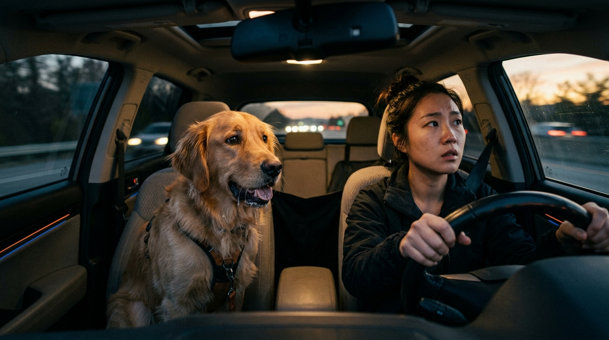 | 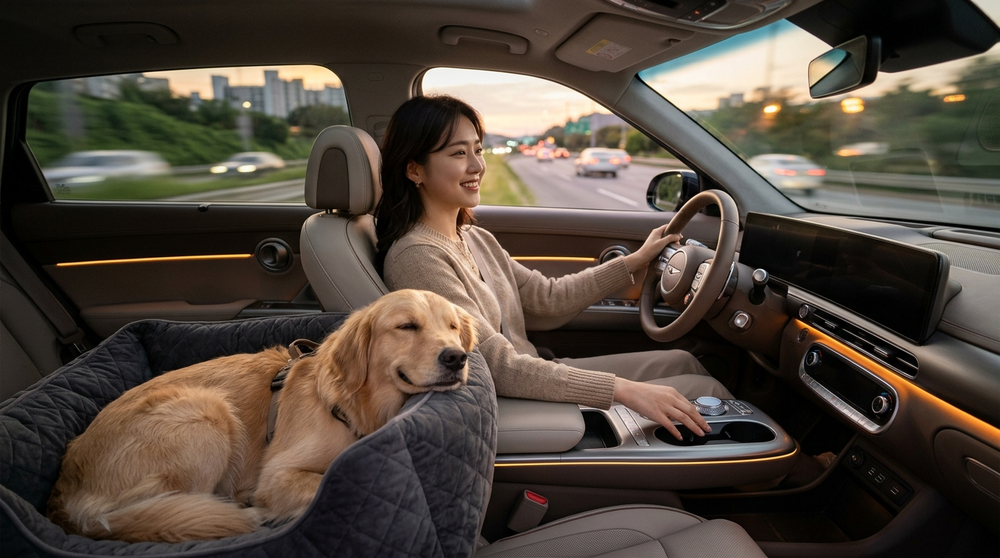 |
| **사람보다 4배 민감한 청각과 흔들리는 차체**<br>• 엔진·노면 저주파 진동과 급격한 온도 상승으로 인한 **구토·멀미**<br>• 어두운 **터널 진입 시 굉음과 배기가스**로 인한 패닉 발작<br>• 휴게소 잠깐 정차 시 **분리불안** 및 **발로 창문 버튼을 밟는 추락 사고 위험**<br>• 운전 중 에어컨·풍향·창문·조명·음악을 각각 조작하느라 발생하는 **전방 주시 태만** | **차량 하드웨어 + 음향 테라피 원터치 오케스트레이션**<br>• **원터치 프리셋 1번 터치**로 조명·온도·하향 송풍·창문·2열 시트통풍·사운드 동시 세팅<br>• **터널 진입 안전 확인 팝업** 후 4도어 창문 밀폐 + 내기순환 + 110Hz 저주파 차폐음 가동<br>• **5분 휴게소 안심** 시 창문 조작 잠금(`Window Lock`) + **보호자 목소리 주기적 믹싱 재생**<br>• 기어 `D` 주행 시 **조명 30% 이하 자동 감광** 및 **내비 안내 시 볼륨 20% 자동 감쇠(Ducking)** |

---

## 2. 🌟 2대 플래그십 안전 하드웨어 핵심 기능 & 시나리오별 시각 가이드 (Visual Guide)

처음 보는 분들도 앱을 어떻게 사용하는지, 그리고 각 버튼을 눌렀을 때 실제 자동차 실내 공간이 어떻게 변하는지 직관적으로 이해할 수 있도록 **`Pleos_Connect_AVD` 실제 가동 캡처 화면**과 **차량 실내 공간 렌더링 이미지**를 1:1로 매칭했습니다. 특히 스마트폰 앱으로는 불가능하고 **오직 차량 VHAL 하드웨어 제어(Pleos SDK)로만 해결할 수 있는 [🚇 터널 세이프가드]와 [⏱️ 5분 휴게소 안심 가디언]을 2대 플래그십 핵심 기능**으로 전면에 배치했습니다.

---

### [★ 핵심 기능 1] 🚇 터널 세이프가드 & 창문 끼임 방지 안전 팝업 (TUNNEL SAFEGUARD)
> **왜 핵심 기능인가요?**  
> 고속도로 터널 진입 시 발생하는 **밀폐 공간의 반사 굉음(소음 증폭)**과 **급격한 어둠·배기가스**는 청각이 사람보다 4배 민감한 반려견에게 공포와 패닉 발작을 유발합니다.  
> 이때 열린 창문으로 뛰어내리려 하거나, 운전자가 급하게 창문을 닫다가 **창밖으로 머리를 내민 반려견의 목이 끼이는 치명적인 안전사고**를 원천 차단하는 **차량 VHAL 창문·공조·조명 통합 제어 기능**입니다.

- **반려견 끼임 방지 2단계 안전 확인 팝업 (`AlertDialog`)**:
  - 창문이 갑자기 닫히면 창밖으로 머리나 발을 내밀고 있던 강아지가 다칠 수 있으므로, 시스템이 즉시 창문을 닫지 않고 반드시 **`[창문 닫고 가동]` / `[창문 유지하고 가동]` 안전 확인 팝업**을 먼저 띄웁니다.
- **차량 하드웨어 제어 동작**:
  - **창문 & 내기순환**: 사용자 승인 시 **4개 도어 창문 100% 밀폐(`setWindowPosition(0)`)** + **내기순환(`Recirculation ON`)** 으로 터널 배기가스를 완벽 차단합니다.
  - **조명 & 차폐 사운드**: 급격한 조도 변화를 완화하는 **웜 화이트(`#FFF3E0`, 40%)** 조명 점등 + 터널 저주파 공명음을 상쇄하는 **110Hz·55Hz 노이즈 캔슬 드론 사운드**를 출력합니다.

| Step 1. 창문 자동 닫힘 안전 확인 팝업 (`manual_02`) | Step 2. 터널 세이프가드 가동 대시보드 (`manual_03`) |
| :---: | :---: |
| 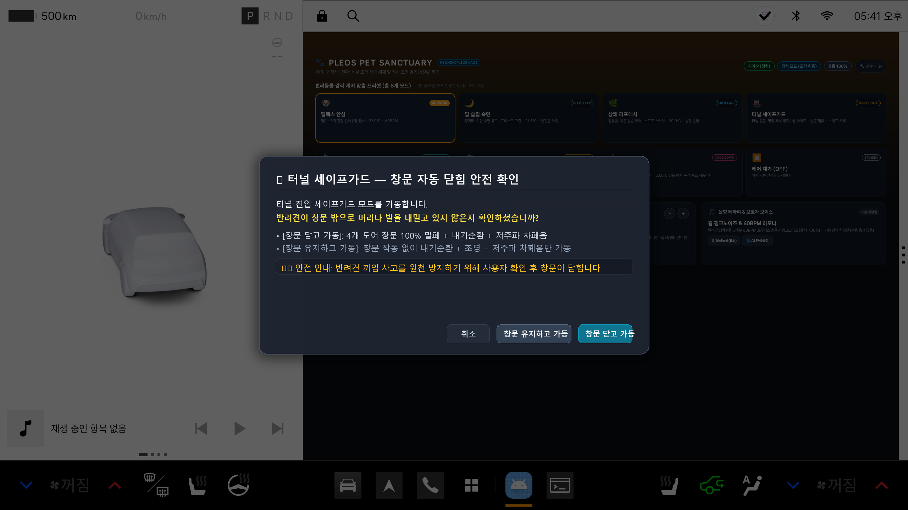 |  |

| Step 3. 터널 주행 중 차량 실내 공간 시뮬레이션 (`cabin_02` — 정방향 2열 펫 시트 & 창문 밀폐·내기순환·차폐음) |
| :---: |
| 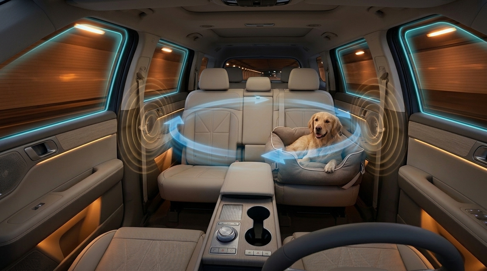 |

> ⚠️ **[현 시점의 플랫폼/SDK 한계점 & 향후 양산 적용]**  
> • **현재 한계**: 현재 공개된 `Vehicle:2.3.2` SDK는 순수 차량 하드웨어(VHAL) 제어 전용 SDK로, 내비게이션 경로상의 '전방 300m 터널 접근 거리' 이벤트 API가 포함되어 있지 않습니다. 따라서 현재는 **운전자의 원터치 프리셋 터치** 또는 **엔지니어링 콘솔의 모의 수신 버튼**으로 안전 팝업이 동작합니다.  
> • **향후 적용**: 향후 현대차그룹 **`Pleos Navigation SDK`**의 경로 이벤트가 공개되면, 백그라운드 서비스(`PetSanctuaryService`) 내부에 이미 100% 구현되어 있는 `BroadcastReceiver`와 다이얼로그 팝업 코드를 그대로 연결하여 **"터널 진입 300m 전 자동 팝업 트리거"**로 즉시 확장 가능하도록 설계되어 있습니다.

---

### [★ 핵심 기능 2] ⏱️ 5분 휴게소 안심 가디언 & 윈도우 락 · 보호자 보이스 (QUICK STOP GUARDIAN)
> **왜 핵심 기능인가요?**  
> 장거리 운전 중 휴게소 화장실이나 픽업을 위해 **기어 `P(정차)` 상태에서 5분 이내로 잠깐 하차**할 때, 홀로 남은 반려견이 겪는 **극심한 분리불안(하울링·발장구)**과 **도어 암레스트 윈도우 스위치를 발로 밟아 창문이 열려 고속도로로 탈출하거나 추락하는 치명적인 사고**를 막아주는 전용 안전 모드입니다.

- **3중 안전 가드 & 보호자 보이스 믹싱**:
  1. **주행 중 진입 차단 & EV 고전압 배터리 보호**: 기어가 `P(정차)`가 아니면 진입이 차단되며, 배터리 잔량(`EvBattery`)이 **20% 미만**이면 방전 사고 방지를 위해 정차 공조 진입을 자동 제한합니다.
  2. **창문 조작 잠금 (`setWindowLock(true)`)**: 반려견이 발로 도어 스위치를 밟아도 창문이 열리지 않도록 하드웨어 윈도우 락을 강제 체결합니다.
  3. **보호자 안심 음성 녹음(5초 카운트다운) / AI 한국어 TTS / 미리듣기(`▶️`)**: 우측 하단 카드의 **`[🎙️ 음성녹음(5초)]`** 또는 **`[🗣️ AI 안심음성]`**을 통해 저장된 보호자의 다정한 목소리가 4초 주기로 배경 차임벨 위에 부드럽게 믹싱 재생됩니다.
  4. **5분(300초) 정밀 타이머 & 장기 방치 경고 배너**: 5분이 경과하면 즉시 복귀를 촉구하는 경고 배너로 전환되며, 보호자가 돌아올 때까지 공조(21.0℃)와 창문 잠금은 안전하게 유지됩니다.

| 5분 휴게소 안심 가디언 & 보호자 보이스 ON 화면 (`manual_05`) | 휴게소 정차 중 창문 잠금 & 보호자 음성 홀로그램 시뮬레이션 (`cabin_04`) |
| :---: | :---: |
| 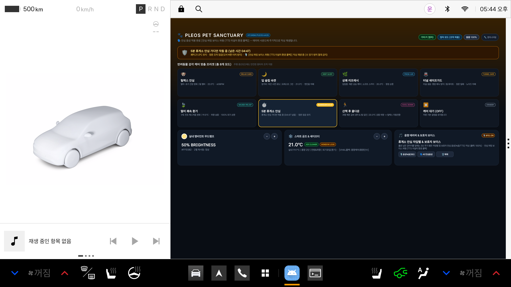 | 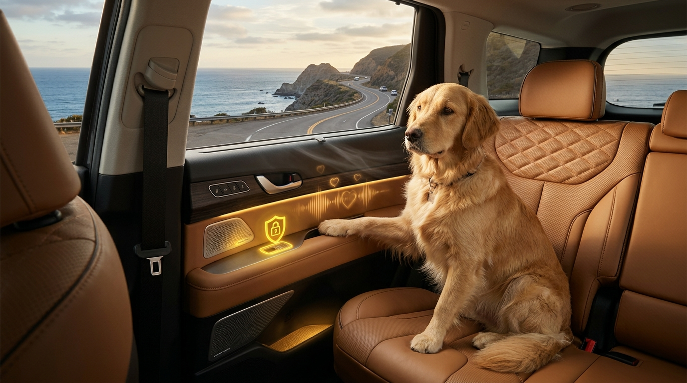 |

> ⚠️ **[현 시점의 플랫폼/SDK 한계점 & 향후 양산 적용]**  
> • **현재 한계**: 5분 타이머, 기어 P단/EV 배터리 20% 안전 규제, 윈도우 락은 100% 작동하지만, 현재 AAOS 및 에뮬레이터 환경에는 2열 탑승 반려견의 실시간 심박수·호흡수나 비전 행동(침 흘림, 하울링)을 읽어오는 물리적 인캐빈 생체 센서 SDK가 부재합니다.  
> • **향후 적용**: 향후 실차 **2열 인캐빈 AI 카메라** 및 **60GHz 레이더 센서 SDK** 연동 시, 반려견의 분리불안 하울링이나 체온 상승 감지 시 운전자 스마트폰 앱으로 즉시 원격 알림을 전송하고 능동 쿨다운 모드로 자동 전환하도록 아키텍처가 완성되어 있습니다.

---

### [일상 감각 케어 3] 🐶 기본 주행 케어 — `릴렉스 안심 (RELAX CARE)`
> **언제 쓰나요?** 반려견을 태우고 처음 출발할 때, 낯선 차 안 환경으로 인한 초기 긴장과 가벼운 멀미를 예방할 때 터치합니다.
- **차량 하드웨어 동작**:
  - **실내 조명**: 반려견의 시각적 긴장을 낮추는 **웜 앰버(`#FFB74D`, 밝기 45%)** 무드램프 점등 + 눈부심 유발 **2열 천장 독서등 자동 소등(`OFF`)**
  - **스마트 공조**: **22.0℃** 쾌적 온도 유지 + **실내 공기청정(`AIR CLEANER`) 가동**
  - **음향 테라피**: 대형견의 안정 시 심박수와 유사한 **60BPM 로우패스 화음(216Hz·324Hz) + 웜 핑크노이즈** 실시간 합성 출력

| 실제 작동 AAOS 대시보드 화면 (`manual_01`) | 차량 실내 공간 변화 시뮬레이션 (`cabin_01`) |
| :---: | :---: |
| 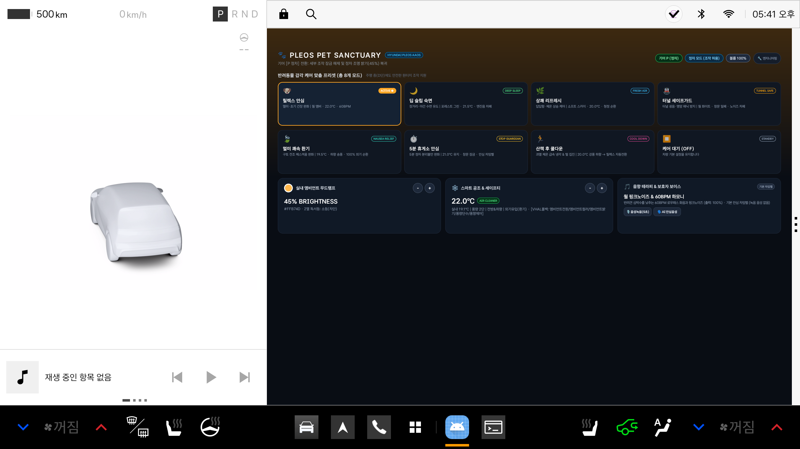 |  |

---

### [일상 감각 케어 4] 🍃 구토 전조 완화 & 산책 후 급속 냉각 — `멀미 쾌속 환기` & `산책 후 쿨다운`
> **언제 쓰나요?**
> - **`🍃 멀미 쾌속 환기`**: 강아지가 하품을 반복하거나 침을 흘리는 등 **멀미(구토 전조) 증상**을 보일 때 즉시 체온을 낮추고 신선한 공기를 공급합니다.
> - **`🏃 산책 후 쿨다운`**: 야외 산책이나 애견 운동장 직후 헐떡이는 강아지의 열기를 식히고 날리는 털을 집진할 때 켜면 **7분(420초) 급속 냉각 후 자동으로 `릴렉스 안심` 모드로 전환**됩니다.
- **차량 하드웨어 동작**:
  - **얼굴 직바람 방지 하향 송풍 (`FanDirectionType.FLOOR`)**: 강아지 눈·코 점막이 마르지 않도록 **발 밑(하향) 송풍구로만 시원한 바람(19.5~20.0℃, 풍량 4~5단)** 을 보내 바닥부터 2열 시트 주변으로 부드럽게 냉기가 올라오게 제어합니다.
  - **2열 시트 통풍 연동 (`Seat API`)**: 두 모드 및 `상쾌 리프레시` 가동 시 **2열 반려견 시트 통풍(`setHvacSeatVentilation`)** 이 함께 작동하여 배와 등 쪽 열기를 빠르게 식혀줍니다.

| 멀미 쾌속 환기 작동 화면 (`manual_04`) | 산책 후 쿨다운 7분(07:00) 타이머 화면 (`manual_06`) |
| :---: | :---: |
| 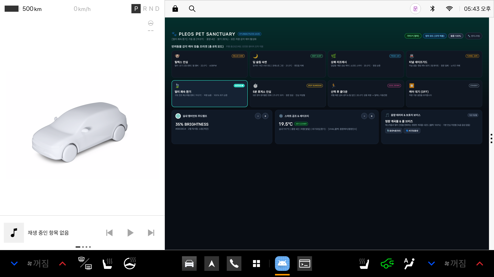 | 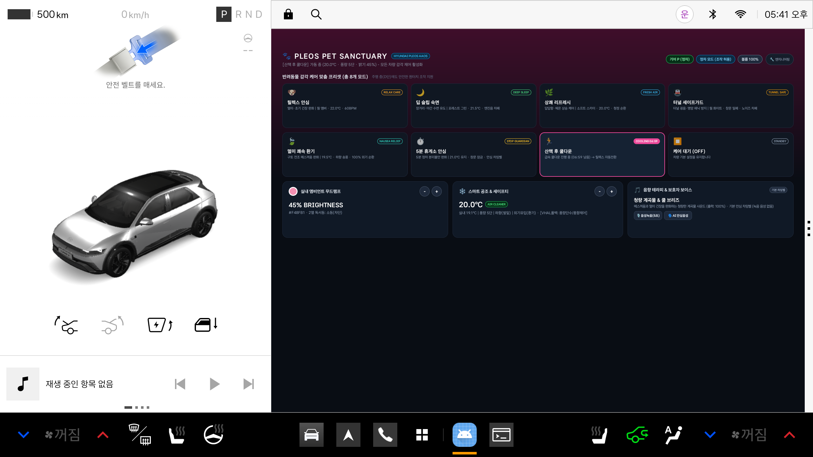 |

| 하향 송풍(`FLOOR`) 에어플로우 & 2열 시트 통풍·공기청정 실내 시뮬레이션 (`cabin_03`) |
| :---: |
|  |

---

### [안전 통제 & 콘솔 5] 주행 안전 규제(`CarUxRestrictions`), 내비 20% 덕킹, 시뮬레이터 콘솔 & 원상복구(`OFF`)
- **주행(기어 `D`) 자동 감광 & 미세 조작 잠금 (`manual_07`)**:
  - 기어가 `D/R/N`으로 변속되면 전면 유리 야간 빛 반사를 막기 위해 **무드램프 밝기가 즉시 30% 이하로 자동 디밍**되며, 운전자의 시선을 뺏는 `[+/-]` 미세 조절 버튼과 음성 녹음 버튼이 반투명 잠금 처리됩니다. (`🔊 사운드 켜짐 / 🔇 음소거` 원터치 토글과 상단 프리셋 카드는 주행 중에도 안전하게 조작 가능)
  - 내비게이션 음성 안내가 나오면 `AudioFocus`를 감지하여 테라피 사운드 볼륨을 **100% → 20%로 자동 감쇠(Ducking)** 시킵니다.
- **엔지니어링 시뮬레이터 콘솔 (`manual_08`) & `OFF` 원상복구 (`manual_09`)**:
  - 우측 상단 **`[🔧 엔지니어링]`** 버튼을 누르면 실차 주행 없이도 `기어 P/D 전환`, `내비 음성 20% Duck`, `터널 300m 전 감지 모의` 등을 즉시 테스트하고 실시간 SDK 이벤트 로그를 확인할 수 있습니다.
  - **`[⏹ 케어 대기 (OFF)]`** 카드(또는 상단 알림바의 **`[케어 종료 (OFF)]`** 버튼)를 누르면 케어 진입 전에 저장해 둔 운전자의 원래 에어컨 온도·풍향·조명 밝기·창문 잠금·시트 통풍 상태로 **100% 원상복구**됩니다.

| 주행(기어 D) 안전 규제 & 내비 20% 덕킹 (`manual_07`) | 엔지니어링 시뮬레이터 콘솔 (`manual_08`) | 케어 종료(OFF) 및 원래 설정 복원 (`manual_09`) |
| :---: | :---: | :---: |
| 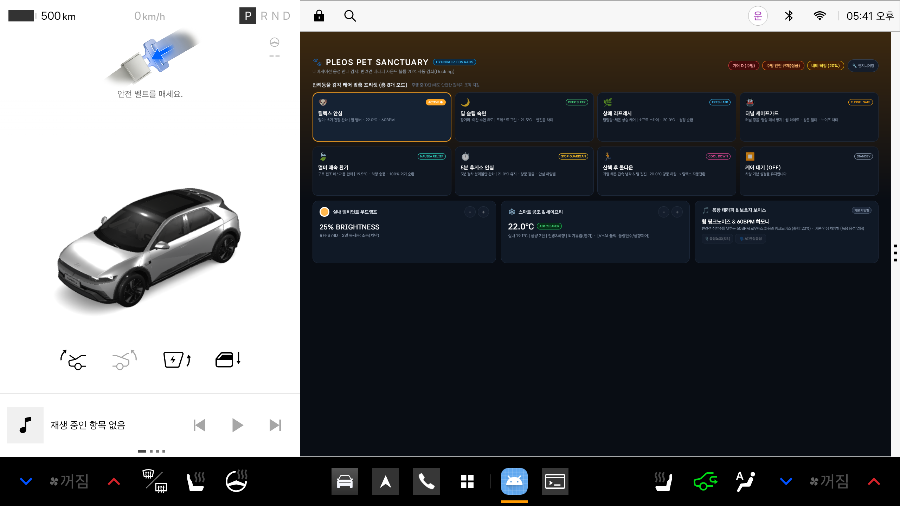 | 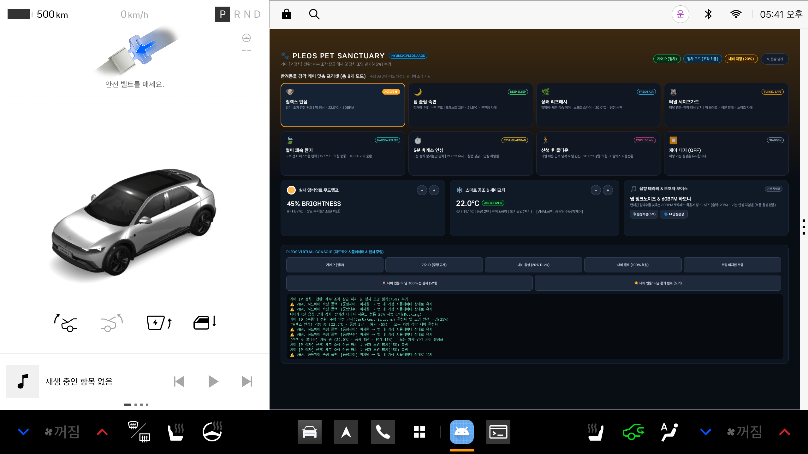 | 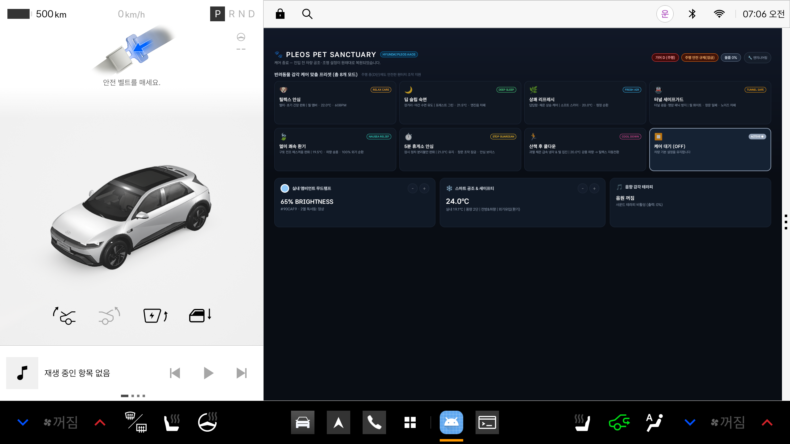 |

---

## 3. 8대 원터치 감각 케어 프리셋 한눈에 보기

| 프리셋 모드 | 핵심 케어 목적 | 무드램프 색상 & 밝기<br>(정차 P → 주행 D) | 공조 온도 · 풍량 · 풍향 · 순환 | 창문 · 독서등 · 2열 시트통풍 | 실시간 합성 사운드 프로파일 |
| :--- | :--- | :--- | :--- | :--- | :--- |
| **🐶 릴렉스 안심**<br>(`RELAX`) | 탑승 초기 긴장 및 가벼운 멀미 완화 | 웜 앰버 (`#FFB74D`)<br>**45% → 25%** | **22.0℃** · 2단 · 전방&하향 · 공기청정 ON | 2열 독서등 소등 | **60BPM 하모니 & 웜 핑크노이즈** (`216Hz`·`324Hz`) |
| **🌙 딥 슬립 숙면**<br>(`DEEP_SLEEP`) | 장거리·야간 주행 수면 유도 | 포레스트 그린 (`#66BB6A`)<br>**20% → 15%** | **21.5℃** · 1단(저소음) · 전방&하향 · 청정 ON | 2열 독서등 소등 | **딥 브라운노이즈 (엔진 저주파 차폐)** (`128Hz`) |
| **🌿 상쾌 리프레시**<br>(`FRESH_AIR`) | 실내 답답함 해소 및 산뜻한 환기 | 소프트 스카이 (`#4FC3F7`)<br>**50% → 30%** | **20.0℃** · 3단 · 전방&하향 · 공기청정 ON | 2열 독서등 소등 · **2열 시트통풍 ON** | **어쿠스틱 레인 & 시냇물 사운드** (`320Hz`) |
| **🚇 터널 세이프가드**<br>(`TUNNEL_SAFEGUARD`) | 터널 반사 굉음·조도 급변·배기가스 차단 | 웜 화이트 (`#FFF3E0`)<br>**40% → 30%** | **22.0℃** · 3단 · **내기순환 ON** · 공기청정 ON | **안전 팝업 후 4도어 창문 100% 밀폐** · 독서등 소등 | **110Hz·55Hz 터널 저주파 차폐 드론** |
| **🍃 멀미 쾌속 환기**<br>(`NAUSEA_RELIEF`) | 구토 전조(침 흘림·하품) 긴급 완화 | 쿨 민트 (`#80CBC4`)<br>**35% → 25%** | **19.5℃** · 4단 · **하향(`FLOOR` 직바람 방지)** · **100% 외기유입** | 2열 독서등 소등 · **2열 시트통풍 ON** | **청량 계곡물 & 쿨 브리즈** (`340Hz`) |
| **⏱️ 5분 휴게소 안심**<br>(`QUICK_STOP_GUARDIAN`) | 정차(`P`) 중 5분 하차 분리불안·창문사고 예방 | 골든 옐로우 (`#FFE082`)<br>**50% (정차 P 전용)** | **21.0℃** · 2단 · 공기청정 ON · **300초(5분) 타이머** | **창문 조작 잠금(`Window Lock ON`)** · 배터리 ≥ 20% 가드 | **3초 주기 안심 차임벨 + 보호자 음성 믹싱** (`260Hz`) |
| **🏃 산책 후 쿨다운**<br>(`POST_PLAY_COOLDOWN`) | 산책 직후 과열 체온 급속 냉각 & 털 집진 | 소프트 코랄 (`#F48FB1`)<br>**45% → 25%** | **20.0℃** · **5단 강풍** · **하향(`FLOOR`)** · **420초(7분) 후 릴렉스 자동전환** | 2열 독서등 소등 · **2열 시트통풍 ON** | **청량 계곡물 & 쿨 브리즈** (`340Hz`) |
| **⏹ 케어 대기 (OFF)**<br>(`OFF`) | 케어 종료 및 진입 전 차량 상태 원상복구 | 진입 전 원래 색상/밝기 복원 | 진입 전 원래 온도·풍량·풍향·내외기 복원 | 기존 창문 잠금 상태 보존 및 시트통풍 복원 | 사운드 즉시 종료 및 `AudioFocus` 반환 |

---

## 4. 실제 구현된 핵심 기능 및 안전 설계 (How It Works)

### 4.1 Pleos Vehicle SDK (`v2.3.2`) 6대 도메인 통합 제어 & 동적 Capability 탐색
- **6대 차량 하드웨어 도메인 완비**: [`PleosSdkVehicleHal.kt`](app/src/main/java/ai/pleos/petsanctuary/hal/PleosSdkVehicleHal.kt)에서 현대차그룹 공식 SDK(`ai.pleos.playground:Vehicle:2.3.2`)의 **`Light`, `HVAC`, `Window`, `Gear`, `Seat`, `EvBattery`** 를 모두 연동했습니다.
- **왜 `check*Capabilities`를 먼저 호출하나요?**:
  - 차량마다 에어컨 온도 제어는 운전석/조수석(`areaId=1, 4`)만 허용하고, 에어컨 전원은 5인승 전체 좌석(`areaId=117`)만 허용하는 등 프로퍼티별 허용 구역(`SeatArea`/`WindowArea`) 비트마스크가 다릅니다.
  - 본 앱은 초기화 시 모든 도메인의 `check*Capabilities`를 먼저 조회해 해당 차량이 실제 지원하는 구역 리스트를 동적으로 확보한 뒤 명령을 전송하므로 `IllegalArgumentException` 없이 안전하게 동작합니다.

### 4.2 실시간 절차적 사운드 신디사이저 & 보호자 안심 보이스 믹서
- **외부 오디오 파일(MP3/WAV) 의존성 Zero**: [`PetSoundEngine.kt`](app/src/main/java/ai/pleos/petsanctuary/audio/PetSoundEngine.kt)가 `22,050Hz` 16-bit Mono PCM 버퍼에서 수학적 파형(사인파 화음 + 1차 IIR 로우패스 필터 브라운노이즈 + 벨 엔벨로프)을 실시간 합성하여 용량 부담과 루프 끊김이 전혀 없습니다.
- **보호자 안심 음성 3종 지원 (마이크 녹음 / AI TTS / 폴백 파형)**:
  1. **`🎙️ 음성녹음(5초)`**: `AudioRecord`로 보호자의 실제 목소리를 5초간 녹음(실시간 카운트다운 표시 및 저감도 마이크 최대 4배 자동 증폭 정규화)하여 내부 저장소에 영구 보관합니다.
  2. **`🗣️ AI 안심음성`**: 마이크가 없는 환경이나 에뮬레이터에서도 즉시 테스트할 수 있도록 Android `TextToSpeech.synthesizeToFile()`로 *"아가야 안심해, 보호자가 곧 돌아옵니다"* 음성을 생성해 `22,050Hz`로 리샘플링합니다. (TTS 엔진 미설치 이미지에서는 따뜻한 보컬 포먼트 허밍 파형으로 자동 폴백)
  3. **`▶️ 미리듣기` & `🔇 사운드 단독 음소거`**: 4초 주기를 기다리지 않고 녹음/합성된 음성을 즉시 1회 들어볼 수 있으며, 공조·조명은 유지한 채 사운드만 원터치로 음소거할 수 있습니다.

### 4.3 스냅샷 기반 완벽 원상복구 (`VehicleBaselineSnapshot`)
- 케어 모드를 처음 켤 때 진입 전 차량의 온도, 풍량, 풍향, 내외기, 무드램프 전원/색상/밝기, 2열 시트 통풍, 그리고 **운전자가 원래 잠가두었던 창문 잠금 상태**를 [`VehicleBaselineSnapshot`](app/src/main/java/ai/pleos/petsanctuary/model/PetSanctuaryState.kt)에 저장합니다.
- 특히 운전자가 아이나 반려견을 위해 이미 창문을 잠가둔 상태에서 일반 케어 모드(`릴렉스 안심` 등)를 켜더라도 **기존 창문 잠금을 절대 강제로 풀지 않고 보존**하며, `OFF` 시 원래 상태로 정확히 되돌립니다.

---

## 5. 시스템 아키텍처 & Pleos SDK 연동 구조도 (Architecture)

### 5.1 4-Layer 단방향 데이터 흐름 아키텍처 (UDF)

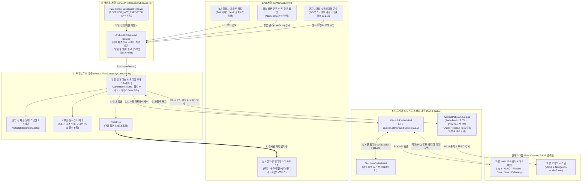

---

### 5.2 Pleos Vehicle SDK (`v2.3.2`) 6대 도메인 클래스 연동도

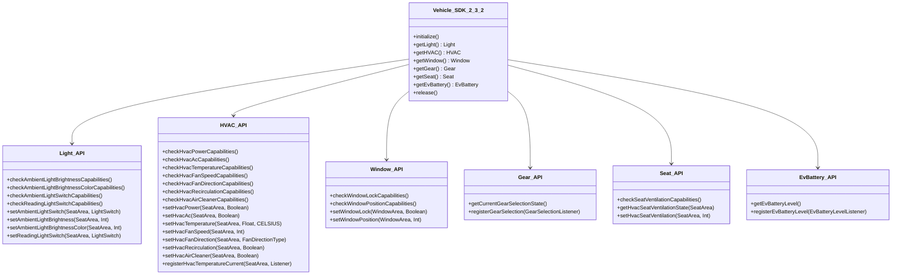

---

## 6. 플랫폼 환경 특성(한계점) 및 향후 양산 확장 로드맵 (Limitations & Roadmap)

본 프로젝트는 **실제 구현 완료된 기능**, **에뮬레이터 시스템 이미지의 환경적 특성**, 그리고 **향후 실차 양산 단계의 고도화 과제**를 거짓 없이 투명하게 구분하여 정리했습니다.

### 6.1 AAOS 에뮬레이터 VHAL 환경 특성 (앱의 결함이 아닌 에뮬레이터 이미지 특성 및 방어 설계)
- **현상**: `Pleos_Connect_AVD` 에뮬레이터에서 `Light`(전원·밝기·색상·독서등), `HVAC`(전원·A/C·목표온도·공기청정·내외기), `Window`(창문잠금·창문개폐), `Gear`, `Seat`, `EvBattery` API를 호출할 때, 일부 하위 VHAL 속성(`HVAC_FAN_SPEED`, `HVAC_FAN_DIRECTION` 등)은 에뮬레이터 내부 VHAL 데몬이 `PropertyAsyncError(code=2)`를 반환하는 경우가 있습니다.
- **원인 및 앱의 방어 아키텍처**:
  - 이는 앱 코드의 버그가 아니라 **에뮬레이터 VHAL 시스템 이미지에 구현된 가상 하드웨어 프로퍼티 범위의 특성**입니다.
  - 본 앱은 이를 완벽히 방어하기 위해 **`PleosSdkVehicleHal` ↔ `SimulatedVehicleHal` 이중 폴백(Dual-Layer Graceful Fallback) 아키텍처**를 구현했습니다.
  - 메인 대시보드 UI는 실제 양산차와 동일하게 운전자 친화적인 **`"차량 제어 연동"`** 상태를 표시하며, 개발자나 심사위원이 **`[🔧 엔지니어링]`** 콘솔을 열면 어떤 VHAL 속성이 에뮬레이터에서 폴백 처리되었는지 로그로 투명하게 확인할 수 있습니다.

### 6.2 현재의 한계점 및 향후 실차 적용 로드맵 (Future Works)

| 영역 | 현재 구현 완료 범위 (Current State) | 현재의 환경적 한계점 (Limitation) | 향후 양산 고도화 방향 (Future Roadmap) |
| :--- | :--- | :--- | :--- |
| **1. 내비게이션 터널 300m 전방 자동 감지** | • `PetSanctuaryService` 내부에 터널 진입/이탈 `BroadcastReceiver`(`RECEIVER_NOT_EXPORTED`) 및 **창문 끼임 방지 안전 확인 팝업(`AlertDialog`) 100% 구현 완료**<br>• 카드 원터치 또는 엔지니어링 콘솔 모의 버튼으로 즉시 작동 | 현재 공개된 `Vehicle:2.3.2` SDK는 차량 하드웨어(VHAL) 제어 전용 SDK이므로, 내비게이션 경로상의 전방 터널 거리(300m) 이벤트 API는 포함하고 있지 않음 | • **Pleos Navigation / Map SDK 경로 이벤트 연동**<br>• 또는 **`FusedLocationProviderClient` + 전국 터널 입출구 좌표 DB(국토교통부 표준데이터) 지오펜싱**을 결합해 터널 300m 전방 자동 팝업 트리거 구현 |
| **2. 2열 반려견 생체·행동 센서 연동** | • 보호자의 8대 원터치 프리셋 선택 + **정밀 코루틴 타이머(5분 가디언 / 7분 쿨다운 자동 전환)** + 기어(`P/D`)·배터리(`20%`) 실시간 센서 반응형 제어 구현 | 차량 내 반려견의 실시간 심박수나 구토 전조 행동을 감지하는 물리적 인캐빈 카메라/레이더 센서가 에뮬레이터 환경에 없음 | • 실차 **2열 인캐빈 AI 카메라(침 흘림·안절부절못함 비전 인식)** 및 **60GHz 레이더 호흡/심박 센서**와 연동하여 스트레스 징후 감지 시 최적 케어 모드 자동 제안 |
| **3. 실차 LED 색상표 & 견종별 맞춤 프로필** | • VHAL 표준 색상 인덱스(`pleosColorIndex`) 전송 및 대시보드 오라(Aura) 글로우 실시간 연동 완료 | 차종·연식별로 VHAL 정수 팔레트 번호와 실제 도어 트림 LED 발광 색상이 다를 수 있음 | • 현대·제네시스 차종별 실차 LED 컬러 룩업 테이블(LUT) 1:1 캘리브레이션<br>• 단모종/장모종/노령견 등 **반려견 프로필별 맞춤 온도·사운드 프리셋 추천** 추가 |

---

## 7. 설치·실행 방법 및 테스트 환경 (How to Run)

### 7.1 개발 및 검증 환경
| 구분 | 상세 사양 |
| :--- | :--- |
| **타깃 OS / 플랫폼** | Android Automotive OS (AAOS) / Pleos Connect 에뮬레이터 (`Pleos_Connect_AVD`, x86_64) |
| **Android SDK 버전** | `minSdk = 28` (Android 9.0+), `compileSdk = 34`, `targetSdk = 34` |
| **언어 및 빌드 도구** | Kotlin `1.9.24`, JDK `17`, Gradle `8.11.1`, Android Gradle Plugin `8.5.2` |
| **핵심 연동 SDK** | `ai.pleos.playground:Vehicle:2.3.2` (Pleos Vehicle SDK 6대 도메인 연동) |
| **디스플레이 대응** | 차량용 와이드스크린(`2560×1440`, 2×4 그리드) 및 분할 화면(`width < 900dp`, 4×2 반응형 그리드) 자동 대응 |

### 7.2 실행 방법 A — 사전 빌드된 Release APK 바로 설치 (권장)
저장소 내 [`apk/`](apk/) 폴더에 서명 완료된 최신 Release APK가 포함되어 있어 빌드 없이 즉시 설치·실행할 수 있습니다.

```bash
# 1. Pleos Connect AAOS 에뮬레이터(또는 ADB 연결 기기)에 Release APK 설치
adb install -r apk/PleosPetSanctuary_release.apk

# 2. 앱 메인 화면 실행
adb shell am start -n ai.pleos.petsanctuary/.ui.MainActivity
```

### 7.3 실행 방법 B — Android Studio 또는 Gradle CLI에서 직접 빌드
```bash
# 1. 20개 도메인·안전·타이머·보이스 JUnit 단위 테스트 전체 실행
./gradlew testDebugUnitTest

# 2. Debug 및 Release APK 빌드
./gradlew assembleDebug assembleRelease
```

---

## 8. 20개 JUnit 단위 테스트 검증 및 프로젝트 문서 안내

### 8.1 JUnit 단위 테스트 검증 목록 (`20 Tests Passed, 0 Failures`)
[`PetSanctuaryControllerTest.kt`](app/src/test/java/ai/pleos/petsanctuary/PetSanctuaryControllerTest.kt)를 통해 모든 프리셋 동작, 안전 규제, 타이머, 스냅샷 복원, 보이스 제어, 배터리 가드를 검증했습니다.

```text
[Gradle Unit Test Results - 20 Tests Passed in 0.169s]
  ✔ presetActivation_appliesLightHvacAndAudioCorrectly
  ✔ tunnelSafeguard_sealsWindowsEnablesRecirculationAndNoiseDrone
  ✔ tunnelSafeguard_respectsWindowCloseConfirmationOverride
  ✔ nauseaRelief_setsFloorDirectionFreshAirAndCoolTemp
  ✔ quickStopGuardian_locksWindowsAndActivatesGuardianVoice
  ✔ quickStopGuardian_countsDownFiveMinutesAndEmitsExpiryWarning
  ✔ quickStopGuardian_blockedDuringDrivingAndWhenEvBatteryLow
  ✔ postPlayCooldown_setsHighFanAndCooldownTimer
  ✔ postPlayCooldown_transitionsAutomaticallyToRelaxAfterSevenMinutes
  ✔ rearSeatVentilation_activatesForCoolingModesAndRestoresOnOff
  ✔ snapshotRestore_restoresOriginalVehicleSettingsWhenTurnedOff
  ✔ windowLockPreservation_doesNotUnlockExistingDriverWindowLockInNonGuardianModes
  ✔ gearTransition_enforcesSafeDrivingDimmingAndCarUxRestrictions
  ✔ audioFocusDucking_reducesVolumeForNavigationAndRecovers
  ✔ toggleAudioMute_mutesAndRestoresIndependentlyOfClimateAndNaviDucking
  ✔ ownerVoiceRecordingAndTts_succeedInParkAndClearCorrectly
  ✔ ownerVoiceControls_blockedDuringDrivingByCarUxRestrictions
  ✔ previewCustomVoice_playsRecordedVoiceAndRespectsDrivingLock
  ✔ gracefulDegradation_handlesLowerTrimWithoutAmbientLightOrAirCleaner
  ✔ boundsClamping_clampsOutOfRangeTemperatureAndBrightness
```

### 8.2 저장소 내 주요 산출물 및 문서 링크
- 📱 **실행 APK 파일**:
  - [`apk/PleosPetSanctuary_release.apk`](apk/PleosPetSanctuary_release.apk)
  - [`apk/팀명_PleosPetSanctuary_release.apk`](apk/%ED%8C%80%EB%AA%85_PleosPetSanctuary_release.apk)
- 📘 **상세 문서 패키지**:
  - [`1_USER_GUIDE_AND_FEATURES.md`](1_USER_GUIDE_AND_FEATURES.md): 처음 보는 사용자를 위한 앱 사용법 및 8대 프리셋 상세 가이드
  - [`2_ARCHITECTURE_AND_SDK_VISUAL_GUIDE.md`](2_ARCHITECTURE_AND_SDK_VISUAL_GUIDE.md): 다이어그램 중심 4계층 아키텍처, Pleos SDK 6대 도메인 및 한계점/확장 설계서
  - [`3_CONTEST_APPLICATION_DRAFT.md`](3_CONTEST_APPLICATION_DRAFT.md) & [`공모전_접수양식_PleosPetSanctuary_초안.docx`](%EA%B3%B5%EB%AA%A8%EC%A0%84_%EC%A0%91%EC%88%98%EC%96%91%EC%8B%9D_PleosPetSanctuary_%EC%B4%88%EC%95%88.docx): 공모전 심사 규정 준수 참가 신청서
  - [`4_VISUAL_SCREEN_USER_MANUAL.md`](4_VISUAL_SCREEN_USER_MANUAL.md) & [`PleosPetSanctuary_시각적_사용설명서_매뉴얼.pdf`](PleosPetSanctuary_%EC%8B%9C%EA%B0%81%EC%A0%81_%EC%82%AC%EC%9A%A9%EC%84%A4%EB%AA%85%EC%84%9C_%EB%A7%A4%EB%89%B4%EC%96%BC.pdf): 실제 가동 캡처 + 차량 실내 렌더링 통합 비주얼 매뉴얼 (인쇄용 A4 5페이지 PDF 포함)
  - [`SHORT_FORM_VIDEO_PRODUCTION_GUIDE.md`](SHORT_FORM_VIDEO_PRODUCTION_GUIDE.md): Google Flow 1분(10초×6씬) 숏폼 영상 제작 프롬프트 및 스토리보드 가이드

---

## 9. SDK/플랫폼 미제공 기능에 따른 현 시점 한계점 및 향후 제공 시 확장 명세 (Detailed SDK Gap Analysis)

본 장은 현대차그룹 공모전 심사위원 및 개발자를 위해 **"현재 공개된 SDK 및 에뮬레이터 환경에서 지원되지 않아 발생하는 기능적 한계점"** 과, **"향후 해당 SDK/API 및 하드웨어가 제공될 경우 즉시 플러그인 가능한 확장 구조"** 를 가감 없이 솔직하게 정리한 기술 분석서입니다.

<p align="center">
  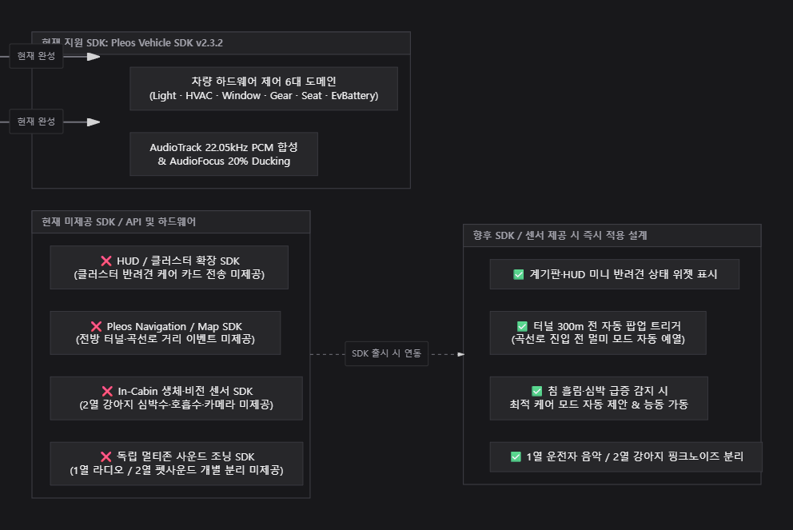
</p>

---

### 9.1 현 시점의 SDK 한계점 & 향후 제공 시 적용 계획 (5대 심층 분석)

| 번호 | 영역 | 현재 SDK/플랫폼 미제공 항목 | 현 시점의 기능상 한계점 | 향후 SDK/하드웨어 제공 시 즉시 적용 설계 (Architecture Ready) |
| :---: | :--- | :--- | :--- | :--- |
| **1** | **내비게이션 & 경로 이벤트** | • **Pleos Navigation / Map SDK 미공개**<br>• 현재 `Vehicle:2.3.2`는 순수 VHAL 하드웨어 제어 라이브러리로, 내비 경로상의 '전방 300m 터널', '급커브 구간', '요금소' 등 주행 환경 이벤트를 전달하는 API가 없음 | • 터널 진입 전 창문 밀폐 팝업이 **자동 트리거되지 않고, 운전자의 원터치 프리셋 터치 또는 엔지니어링 콘솔의 모의 수신 버튼으로 동작**함 | • **연동 준비 완료**: `PetSanctuaryService` 내부에 `ACTION_TUNNEL_APPROACHING` BroadcastReceiver와 `AlertDialog` 안전 팝업이 100% 구현되어 있음.<br>• **향후 적용**: Navigation SDK의 `OnRouteEventListener(TUNNEL, CURVE)`가 공개되면 리시버 발신부 한 줄만 연결하여 **"터널 300m 전 자동 팝업"** 및 **"연속 급커브 1km 전 멀미 쾌속 환기 자동 예열"** 로 즉시 확장 가능 |
| **2** | **2열 인캐빈 생체 & 행동 비전 센서** | • **In-Cabin 반려견 전용 센서 API 부재**<br>• 현재 AAOS 및 에뮬레이터에는 2열 좌석에 탑승한 반려동물의 생체 신호(심박수, 체온, 호흡수)나 비전 행동 인식(침 흘림, 하품, 안절부절못함)을 읽어오는 센서 SDK가 없음 | • 반려견의 멀미나 스트레스 발생을 차가 먼저 알아채지 못하고, **운전자가 룸미러로 상태를 보고 8대 프리셋 카드 중 하나를 직접 터치**해야 함 | • **연동 준비 완료**: `PetSanctuaryController.activatePreset()`이 외부 이벤트 기반으로 언제든 모드를 자동 전환할 수 있도록 StateFlow 아키텍처 구축 완료.<br>• **향후 적용**: 실차 **2열 AI 모니터링 카메라** 및 **60GHz 레이더 센서 SDK** 연동 시, 반려견이 3회 이상 하품하거나 호흡수가 급증하면 화면에 *"반려견 멀미 징후 감지! [멀미 쾌속 환기]를 가동할까요?"* 다이얼로그 자동 제안 구현 |
| **3** | **독립 멀티존 오디오 조닝 (Multi-Zone Sound)** | • **좌석별 개별 사운드 라우팅 API 미제공**<br>• 현재 AAOS Audio HAL은 차량 전체 스피커 또는 Fader/Balance 기반 제어만 기본 제공하며, 1열(운전자)과 2열(반려견)의 오디오 스트림을 완전히 독립된 물리 채널로 분리하는 공용 SDK API가 없음 | • 사운드 테라피(핑크노이즈, 차폐 드론, 보호자 목소리)가 차량 전체 스피커로 출력되므로, 운전자가 라디오나 다른 음악을 들으면서 2열에만 테라피 음원을 틀어주기 어려움 (음소거 토글로 해결 중) | • **향후 적용**: 현대차그룹 프리미엄 사운드 시스템의 **'독립 음향 공간(Sound Zone Control)' SDK** 지원 시, **1열 스피커는 운전자 내비/음악**을 출력하고 **2열 도어·헤드레스트 스피커에만 60BPM 핑크노이즈와 보호자 음성**을 개별 분리 재생하도록 확장 |
| **4** | **디지털 클러스터 & HUD 확장 표출** | • **계기판/HUD 위젯 렌더링 SDK 미제공**<br>• 서드파티 앱이 차량의 12.3인치 디지털 클러스터(계기판)나 헤드업 디스플레이(HUD) 영역에 커스텀 그래픽 카드를 띄울 수 있는 SDK 권한이 제한됨 | • 내비게이션이나 다른 기본 앱을 전체 화면으로 띄워두었을 때, 상단 시스템 알림바(Notification)로만 반려견 상태를 확인할 수 있음 | • **연동 준비 완료**: 포그라운드 서비스 및 상태 복원 스냅샷이 이미 독립 프로세스로 완비됨.<br>• **향후 적용**: 클러스터 연동 SDK 오픈 시, **계기판 우측 위젯에 `[🐾 릴렉스 안심 22.0℃ | 배터리 82%]` 미니 카드를 상시 표출**하여 전방 주시 태만 완전 방지 |
| **5** | **실차 차종별 LED 캘리브레이션 LUT** | • **차종별 하드웨어 색온도 매핑표 미제공**<br>• VHAL 표준 정수 팔레트 번호(`pleosColorIndex`)만 전달 가능하며, 제네시스/아이오닉/EV9 등 실차 도어 트림 LED 광원의 물리적 색온도(CCT)를 1:1 보정하는 SDK 캘리브레이션 맵이 없음 | • 에뮬레이터 대시보드에서는 정확한 헥사코드(`#FFB74D` 웜 앰버 등)로 오라가 빛나지만, 실제 차량 트림에 따라 미세한 앰비언트 색감 차이가 발생할 수 있음 | • **향후 적용**: 현대차그룹의 차종별 VHAL Color Look-Up Table(LUT)이 제공되면, **실차 LED 광학 특성에 맞춘 감성 색상 자동 보정 계수** 적용 |

---

### 9.2 아키텍처적 준비도 (Future-Proof Architecture Summary)

> 💡 **"코드를 새로 짤 필요 없이, 새 SDK가 출시되면 어댑터 클래스 1개만 교체하면 즉시 양산차에 탑재됩니다."**
>
> 본 앱은 위 5가지 한계점을 이미 설계 단계부터 인지하고, **도메인 컨트롤러([`PetSanctuaryController`](app/src/main/java/ai/pleos/petsanctuary/domain/PetSanctuaryController.kt))와 하드웨어 연동 계층([`PetVehicleHal`](app/src/main/java/ai/pleos/petsanctuary/hal/PetVehicleHal.kt))을 인터페이스 기반으로 철저히 분리**해 두었습니다.  
> 따라서 향후 현대차그룹에서 **`Pleos Navigation SDK`** 나 **`In-Cabin Sensor SDK`** 가 추가 배포되더라도, 기존 비즈니스 로직을 전혀 수정할 필요 없이 리스너 어댑터만 추가 등록하면 즉시 완전 자율형 지능 케어로 업그레이드될 수 있도록 **미래 대응형(Future-Proof) 구조**로 완성되었습니다.

